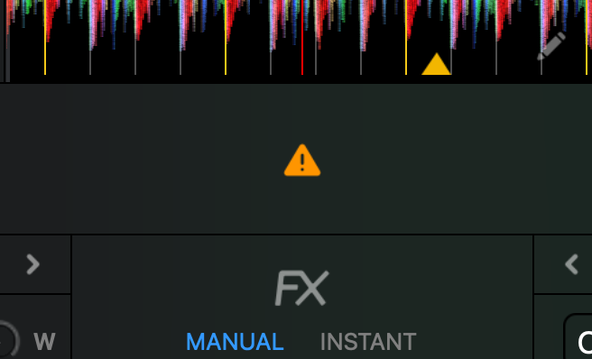
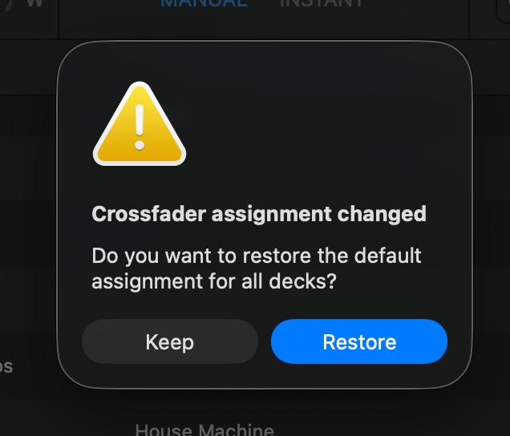
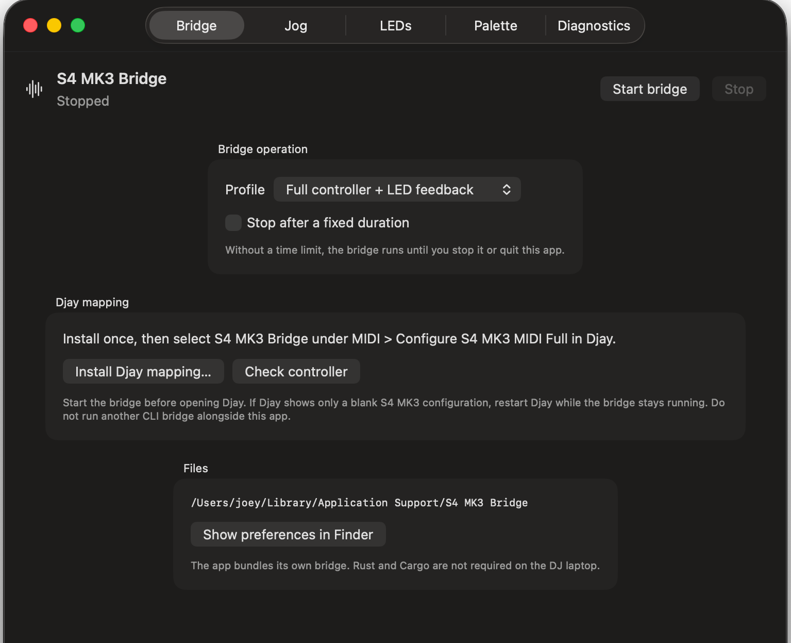
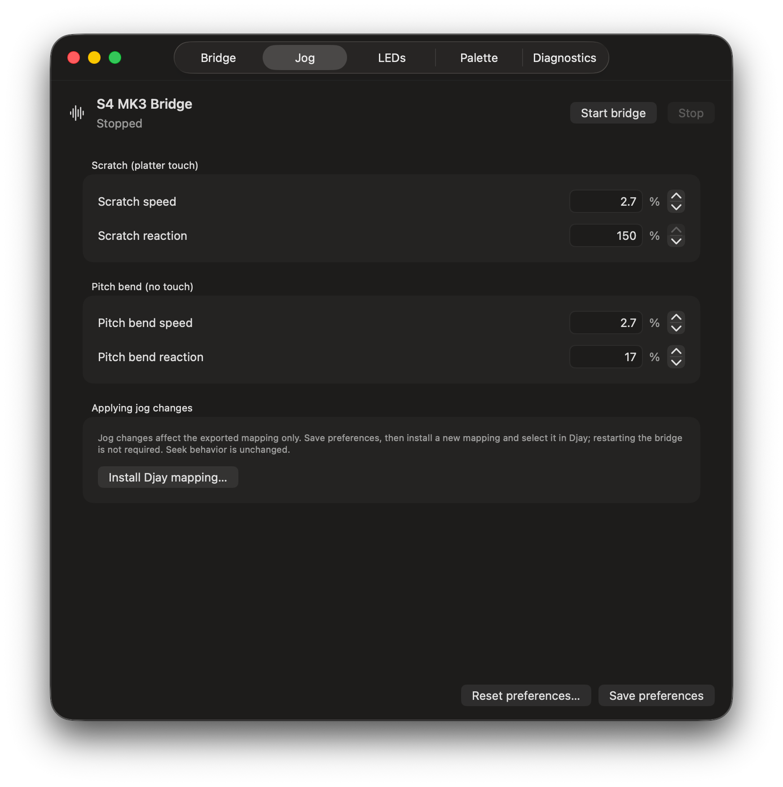

# S4 MK3 HID-MIDI Bridge

Use the Native Instruments Traktor Kontrol S4 MK3 with Djay Pro on macOS
through a menu-bar app. The bridge translates controls and drives LED feedback;
Djay sends audio directly to the S4. No development tools are needed.

**S4 MK3 Bridge** is a beta with a custom Djay mapping, not a recreation
of every Traktor feature. Read the control differences and known limitations
below before using it for a set.

**[User guide: setup, everyday workflows and mapping choices](docs/user-guide.md)**
is the maintained starting point for the current full-controller build.
It explains browsing/preview, loops and jumps, FX pickup, pads, jog feel and
screens without requiring MIDI or development knowledge.

## Requirements

- An Apple Silicon Mac running macOS 12 or later, plus a macOS version supported
  by your installed Djay Pro. (Windows Support is planned!!)
- Djay Pro with **PRO access**, which is required for custom MIDI mappings.
- A Traktor Kontrol S4 MK3, its power adapter, and a USB connection to the Mac.

## Download and install

1. Open [GitHub Releases](../../releases) and choose the latest published release.
2. Download its **`S4 MK3 Bridge-<version>-arm64.dmg`**.
3. Open the disk image, drag **S4 MK3 Bridge** to **Applications**, then eject
   the disk image.
4. Open **S4 MK3 Bridge** from Applications.

**0.2.1-beta.1 (build 7)** adds backspin continuation and motor assistance,
Shift + FX knob effect browsing, and clearer LED/FX feedback. See
[what changed and how to use it](docs/release-0.2.1-beta.1.md).
Version 0.2.0 adds screens, updated Preview/CUE/library controls, startup channel
synchronization, FX pickup and jump-size restoration. Use the app and mapping
supplied together; beta.3's older mapping does not provide these additions.

The app is ad-hoc signed, not Developer ID signed or notarized. macOS may block
the first launch because it can't verify the developer. After attempting to
open it, go to **System Settings > Privacy & Security** and choose **Open Anyway**,
then confirm **Open**. On macOS 12, use **System Preferences > Security & Privacy >
General** instead. Approve it only if you trust the download; there's no need
to disable Gatekeeper.

## First start, mapping, and audio

1. Connect and power on the S4. Run only one bridge instance.
2. Open the app's Settings from its menu-bar icon. Settings opens automatically
   on first launch; **Check controller** can help confirm the connection.
3. Select the **full-controller profile**, choose continuous operation, and
   click **Start bridge**.
4. Choose **Install Djay mapping…**, save the mapping, and accept Djay's import.
   If necessary, open the saved `.djayMidiMapping` file in Djay.
5. In Djay, enable **S4 MK3 MIDI Full** and select **S4 MK3 Bridge** as its
   mapping. Repeated imports may add a number to the name. Use the four-deck
   layout to access decks A, B, C, and D.
6. In Djay's audio settings, select the **S4's native audio device** and configure
   Main and Pre-cue outputs for the speakers and headphones. Audio goes directly
   between Djay and the S4, not through the bridge. Master, booth, headphone
   level, and headphone mix controls remain hardware-local.
7. **EXT external inputs require DVS to be turned on in Djay.** Open
   **Settings > DVS**, check **Enable Digital Vinyl Control**, and assign
   the S4 inputs to the decks: Deck 1 **1-2**, Deck 2 **3-4**, Deck 3 **5-6**,
   Deck 4 **7-8**. Apply the assignments and leave DVS enabled.
   EXT does not turn it on automatically. See the
   [illustrated DVS setup](docs/user-guide.md#required-djay-dvs-setup).

**Expected THRU warning:** when a crossfader assignment switch is set to
**THRU**, Djay may show a warning triangle. Clicking it opens **"Crossfader
assignment changed"** and asks whether to restore the default assignment for
all decks. This is expected: THRU intentionally lets that channel bypass the
crossfader. This specific warning does not mean the bridge or mapping is
broken. Choose **Keep** to retain your switch assignments; **Restore** resets
them to Djay's defaults.

If Djay shows only a blank S4 configuration, restart Djay with the bridge
already running. After reconnecting Djay or reselecting its mapping, use
**Stop bridge**, then **Start bridge** to refresh crossfader assignment and curve
initialization.

When updating, install and select the mapping from the new app. Save it under
a new filename and keep any custom mappings under their existing names.
Restarting the bridge alone doesn't update Djay's mapping.

Closing Settings leaves the app running in the menu bar. Use **Stop bridge**
to stop control translation, or **Quit S4 MK3 Bridge** to quit.

_Bridge controls and mapping installation._

## Controls and differences from Traktor

This section and the [user guide](docs/user-guide.md) describe the current
0.2.1-beta.1 build. Backspin continuation, Shift + FX knob browsing and the latest
lamp/FX-warning corrections are not included in 0.2.0-beta.1.

**Current-source addition:** the full profile supports mixer EXT buttons for
per-deck THRU/Internal switching and indicators from Djay's actual THRU state.
Install a newly generated matching mapping. This addition is not a newly
published release. EXT lamp locations are confirmed; integrated switching
acceptance is tracked in the [EXT validation record](docs/ext-input-validation.md).

**Current-source testing build:** TT independently enables motorized playback;
JOG toggles Vinyl red/on and blue/off. Jog settings include a Vinyl startup
default per mode: normal starts on, TT starts off. With TT Vinyl off, braking
or nudging past the provisional speed bounds hands off to Scratch. Normal rings
follow playback and Scratch and hold on pause; TT rings follow the physical
wheel. Jog settings retain experimental tuning controls. Install the newly generated
mapping for explicit Internal-mode feedback. These additions are not in the
published download; see [testing workflow and limits](docs/user-guide.md#testing-motorized-playback).

The mapping covers four-deck transport, touch scratching and pitch bending,
mixing, EQ, headphone cue, loops, browsing, hotcues, samples, Neural Mix, and
effects. A/C and B/D select the deck controlled by each side. Software feedback
drives button and pad LEDs, channel meters, and jog-ring decoration.

These are intentional custom mappings. Djay's loop, Neural Mix, and effect
models differ from Traktor's, so the same labels don't always mean the same
thing.

| Control                            | Behavior in this bridge                                                                                                                                                                                                               |
| ---------------------------------- | ------------------------------------------------------------------------------------------------------------------------------------------------------------------------------------------------------------------------------------- |
| **LOOP turn / press**              | Select loop size / toggle the loop. Loop size is independent of MOVE's jump length, unlike Traktor's shared length.                                                                                                                   |
| **MOVE turn**                      | Jump by the selected jump length, or move the active loop by that length. Each deck keeps its own loop and jump sizes.                                                                                                                |
| **MOVE press**                     | Toggle jump-size selection. Turn MOVE to change the size immediately; press again to exit. The selected deck's selector pulses while selecting. The mode survives deck switches, has no timeout, and clears when the bridge restarts. |
| **Shift+MOVE turn**                | Jump one beat per step in either direction, even during size selection. Current source builds restore the last confirmed jump length afterward; install the matching mapping. |
| **Shift+LOOP turn / press**        | Move the loop region / reloop the stored loop range. Manual loop in/out isn't mapped. These replace Traktor's shifted key/quantize functions.                                                                                         |
| **REV**                            | Reverse only while held. Release ends reverse. It doesn't automatically enable Slip as Traktor enables Flux; use FLUX to control Slip independently.                                                                                  |
| **Sync / Shift+Sync**              | Normal Sync is deck-specific. Shift+Sync on either side cycles Djay's tempo-fader range **globally for all decks**, rather than locking one deck's tempo fader as in Traktor. Djay determines the ranges and their order.             |
| **Channel FX1 / FX2**              | Choose the deck controlled by the left / right FX strip. These are per-deck control targets, not Traktor's shared FX buses or audio-routing assignments.                                                                              |
| **FX strips**                      | Control three manual effects on the target deck. Current-source app + mapping: Shift + parameter knob browses previous/next effects; release Shift for parameter pickup. Shift + effect button retains next-effect selection. See the bank-enable limitation below. |
| **Channel ON and mixer FX**        | ON selects the Instant FX target. ON is white for normal EQ, cyan for Neural Mix EQ, and brighter on the target deck. An active Instant FX overrides that deck's ON with its effect-button color. |
| **Filter, then channel ON**        | Filter flashes cyan awaiting a deck; the next ON toggles only that deck's Neural Mix EQ without changing the Instant FX target. Filter again cancels. Idle Filter is dim cyan; it no longer resets a filter. |
| **STEMS / MUTE**                   | Both select the same Neural Mix layer: four mute pads and four solo pads; Shift with pads 1-4 provides exclusive solo. MUTE isn't a held Traktor-style modifier.                                                                      |
| **REC**                            | Assigned to Djay's Record Sample action. Algoriddim has confirmed a bug with this action; a fix and retest are pending. It is not the set recorder. |
| **Shift+CUE**                      | Jump to the beginning of the song, not the saved start cue. Normal CUE is unchanged. |
| **Playlist / Star buttons**        | Playlist marks/unmarks selected songs. In current source builds, Star switches the library table (Note 11 / B-1); published beta.3 focuses the Queue. |
| **Preview**                        | Hold to preview; turn BROWSER while holding to scrub, then release to stop. Without Preview or Shift, BROWSER browses tracks. If preview gets out of sync with the hold, close it with the mouse. |
| **Shift+BROWSER turn**              | In current source builds, select the next/previous library source. Holding Preview still scrubs instead, including with Shift held. |

HOTCUE pads trigger eight hotcues; Shift clears them. SAMPLES pads play
samples; Shift stops them. A/C share sampler bank 1, and B/D share bank 2.
Neural Mix availability depends on the track and Djay support.

**Source builds include S4 screen support.** Enable it in the **Screens** tab
or with **Enable S4 screens** in the menu bar. HOTCUE and SAMPLES show JUMP,
active LOOP size, KEY and tempo RANGE; STEMS/MUTE shows the reactive mute/solo
legend. Install the mapping from the same app under a new filename, preserving
custom mappings; older mappings lack numeric screen feedback.
The [screen-driver controls](docs/screen-driver-handover.md) can temporarily
stop NIHardwareAgent with confirmation and restore it afterward. Manual recovery
remains available even with screen support off.
Published downloads do not provide powered playback rotation; the
current-source testing addition is described above. Haptic cues remain
unsupported. Motor-assisted wheel tension is available in the full-controller
profile as described below. Published jog-ring animation is decorative. Current
source adds pause/Scratch continuity in normal mode and physical tracking in TT;
neither is an absolute track playhead.

### Startup positions and FX pickup

Current source builds apply all four channel-volume faders and high/mid/low EQ
positions once Djay's mapping is ready. Gain, filter, crossfader position and
tempo are not applied by this startup synchronization.

Shared FX knobs keep Djay's values until you move through their pickup positions.
A mismatched knob blinks its FX button; dry/wet uses the strip's main ON button.
With screens enabled, `FX SYNC` identifies the affected deck, left/right strip,
knobs 1-3 and `W` for dry/wet. A `?` means feedback is unavailable.
These changes are not in the published beta.3 download. See
[setup and operation](docs/controls-state-sync.md).

## App settings

### LEDs and palette

Settings includes deck, stem, and hotcue colors; lamp brightness; loop and
tempo-center indicators; decorative jog-ring animation; and channel-meter
appearance. LED settings can be imported or exported.
Choose **Save and restart** to apply LED changes. A mapping export isn't needed.
Saved LED preferences are preserved across app updates.

The eight selectable Djay hotcue colors are supported: red, orange, blue, yellow,
green, azalea, cyan, and purple. White isn't offered in Djay's hotcue picker;
its separate fallback hasn't been verified.

### Jog wheels

The **Jog > Hardware** section has a shared **Jog Wheel Tension** slider:

- **Assist (-100 to -1):** assists each wheel's own movement while its metal
  top is touched.
- **Neutral (0):** the first-install default.
- **Brake (1 to 100):** resists each wheel's movement, including after release.

Both wheels share the saved setting but respond independently. Channel 1's
fader remains a normal mixer control. This setting applies only to the
full-controller profile: use **Save preferences** before starting, or
**Save and restart** while running. It does **not** require a new Djay mapping.
Stop and Quit clear force; reopening restores the saved value without starting
the bridge. After a USB disconnect, reconnect and explicitly start the bridge.

Brief controller-input gaps no longer close the bridge. Tension clears while
readings are missing and returns automatically after fresh readings and new
wheel movement; Stop/Start is not required. The 50 ms cutoff and touch rules
remain in place. Physical timeout-recovery testing is still pending; see
[timeout recovery](docs/tension-timeout-recovery.md).

#### Djay scratch and pitch-bend response

The separate scratch and pitch-bend sections set Speed and Reaction for all
four decks. The calibrated defaults are:

| Action                   | Speed | Reaction |
| ------------------------ | ----: | -------: |
| Scratch while touching   |  2.7% |     150% |
| Pitch bend without touch |  2.7% |      17% |

Save your preferences, then use **Install Djay mapping…** to export a new
mapping and select it in Djay. Export uses the current editor values and can
run while the bridge is running. **Saving or restarting alone doesn't apply
jog mapping changes.** Keep existing custom mappings under their original names.

Speed and Reaction adjust Djay's response, independently of hardware tension.

#### Backspins

A sharp backward flick in Turntable mode can continue scratching after you
release the platter, following its remaining real movement. Catching or stopping
the wheel ends the backspin.

In **Jog > Backspin**, adjust the detection threshold, **Scratch speed increase**
and **Motor assist strength**. The defaults are **5.6%** extra scratch speed and
motor assistance **on at 100%**. Software speed and motor help are independent
of your normal scratch response and Jog Wheel Tension. Motor help fades out
within one second after release; this is not playback-driven platter rotation.

Use **Save and restart** to apply changes. No mapping export is needed for
backspin options, and upgrading preserves explicit saved choices. See the
[Backspin guide](docs/user-guide.md#backspin-detection) for tuning and details.

_Jog settings with the Backspin controls, 5.6% speed increase and motor assistance
enabled at 100%, alongside neutral tension and calibrated scratch/pitch-bend defaults._

The menu-bar icon turns green while the bridge is running. In source builds,
it turns red if requested screens are blocked or fail while the bridge keeps
running. **Diagnostics** shows the app release and build number alongside the
bridge log.

## Known issues and limitations

See the [current issue checklist](docs/issues.md) for detailed limitations
and remaining checks.

Open bugs and unresolved behavior:

- **Sensor-time safety exit:** reversed wheel-sensor time stops the bridge.
  Keep the exact Diagnostics error if this occurs; it is separate from the
  automatically recovering 50 ms input-gap path.
- **FX bank enable:** the leftmost FX button duplicates slot 1. Whole-bank
  bypass that preserves individual slot states remains unresolved.
- **REC:** recording source, destination/sample slot, and press/hold behavior
  aren't established.
- **MUTE/STEMS:** the current alias works as described above, but a possible
  held modifier and final pad behavior are undecided.
- **EXT and external inputs:** current-source full-profile EXT1-4 switch fixed
  decks 1-4 between THRU and Internal using actual deck feedback. Missing
  feedback means no switch and a dark lamp. Either Shift suppresses the software
  command, preserving hardware Shift+EXT input-type selection. Enable DVS
  manually, leave it on, and assign inputs in Djay's settings. Channel 4's
  route is confirmed, including fader, FX and mix/cue. EXT switching and lamps
  are confirmed on all four channels; remaining mixer-control coverage,
  phono and four-source audio operation still need validation. See the
  [external-audio workflow](docs/user-guide.md#external-audio-through-a-deck).
- **Mapping reconnect/reselection:** automatic detection isn't implemented.
  Stop and start the bridge after either event.
- **Jog-ring position:** the decorative chase continues while a platter is held
  and returns to 12 o'clock when playback stops. Touch/physical-rotation tracking
  and holding the last position are deferred.

Independent loop/jump sizes, global Shift+Sync, per-deck FX targeting, and REV
without automatic Slip are design choices, not outstanding fixes.

## Roadmap

- Broaden backspin validation and refine jog feel, and resolve the open FX, recording,
  pad, and external-input questions.
- Consider jog-ring touch/rotation polish separately. Playback-driven motor
  rotation, other haptics, additional screen pages and pad legends, and an
  on-controller settings gesture remain deferred.
- Explore a standalone hardware bridge longer term, along with other DJ
  applications and simpler guest setup. These aren't features of this beta.

## Beta feedback

Report problems through the repository's Issues tab. Include the app version,
macOS and Djay versions, selected mapping name, deck and modifier/pad mode,
steps to reproduce, and expected versus actual behavior. For jog or LED
problems, a short video helps. Include relevant app **Diagnostics** output,
checking it for private information before sharing.

## Thanks

Thanks to RufusIbiza, maintainer of [Encdr](https://github.com/RufusIbiza/Encdr),
for the S4 MK3 protocol documentation and controller support this bridge builds on.

## Developer and reference documentation

- [User guide and everyday workflows](docs/user-guide.md)
- [macOS app, packaging, and developer checks](macos/README.md)
- [Full mapping layout and test records](docs/full-midi-test.md)
- [Settings and control tuning](docs/configurable-controls.md)
- [Current issue checklist](docs/issues.md)
- [Traktor comparison and historical evidence](docs/traktor-djay-comparison.md)
- [Djay action reference](docs/djay-action-reference.md)
- [Bridge function reference](docs/bridge-function-reference.md)
- [LED feedback](docs/led-feedback.md)
- [Standalone hardware research and board shortlist](docs/hardware-bridge-research.md)
- [Design history](docs/design.md)
