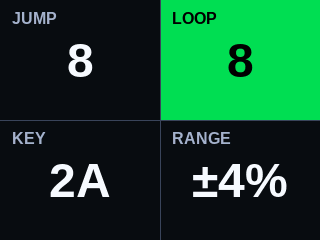
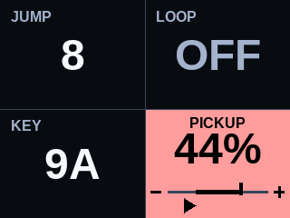
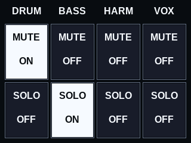
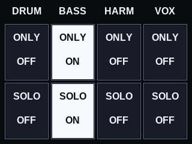

# S4 MK3 Bridge for Djay Pro

### Use your **Traktor Kontrol S4 MK3** with **Djay Pro** on **Mac or Windows**. Screens and motorized jog wheels are fully supported. Includes a custom mapping that aims to be as close as possible to the Traktor workflow, while adding intuitve controls for features unique to Djay.

**[Downloads and release notes](../../releases)** · **[User guide](docs/user-guide.md)** · **[Windows setup](docs/user-guide.md#windows-setup)**

## What you need

- A powered S4 MK3 connected by USB.
- **Mac:** An Apple Silicon Mac running macOS 12 or later and a version of macOS supported by your copy of Djay Pro.
- **Windows:** An x64 PC running Windows 11 25H2 or later with Windows MIDI Services **Basic Loopback**. For NI Bridge, install the S4 controller driver and NI background service; for external audio inputs, install the S4 ASIO driver. The [Windows instructions](docs/user-guide.md#windows-setup) walk through these steps.
- Djay Pro with **PRO access** for custom controller mappings.

## Download and install

**Windows:** On [Releases](../../releases), choose a release that lists a Windows x64 download. Run the **win-x64 Setup.exe**, then open **S4 MK3 Bridge** from Start. If you choose the portable ZIP instead, extract the **entire ZIP** before opening `S4Bridge.exe`; keep its files together. The bridge installer does not install the Microsoft or Native Instruments components. Closing Settings leaves the app in the system tray.

**Mac:**

1. Go to [Releases](../../releases), open the release you want, and download the **arm64 DMG**. Its release notes tell you which features are included.
2. Open the disk image, drag **S4 MK3 Bridge** to **Applications**, then eject the disk image. If you downloaded the ZIP instead, unzip it and move the app to Applications.
3. Launch the app. It lives in the Mac menu bar; closing Settings does not stop it.

If macOS says it can't verify the developer, first make sure you downloaded the app from this project's Releases page. After trying to open it, choose **Open Anyway** in **System Settings → Privacy & Security** (on macOS 12: **System Preferences → Security & Privacy → General**). You don't need to turn off Mac security.

## Play your first track

1. Connect the S4 and its power adapter. Open the bridge's **Settings**. For **Direct HID**, choose the full-controller profile and leave the time limit off. **NI Bridge** already uses the full controller.
2. Click **Start bridge**. **On Windows, wait for Bridge: ready before opening Djay.** Choose **Install Djay mapping…** in the bridge, save under a new name, and accept Djay's import. Use the mapping from the app on that computer, not a mapping copied from the other platform.
3. In Djay's MIDI settings, select **S4 MK3 MIDI Full** (Mac) or **S4 MK3 Bridge BLOOP** (Windows) and choose the imported mapping. In audio settings, select the S4 for **Main** and **Pre-cue**. Keep your outputs low while setting up.
4. Choose **A** or **B** on the S4. Turn **BROWSER** to find a track, hold **Preview** to listen, then release it and press **BROWSER** to load. Press the small channel **CUE** button to check it in headphones.

**Updating?** Install and select the mapping that comes with the new app. Restarting alone doesn't update the controls in Djay. Save the new mapping under a different name to keep any edits to your old one.

## Choose how the platters feel

On either platform, stop the bridge before changing modes in **Settings → Bridge**:

| Choose         | When to use it                                                                                                                                   | What happens to the screens                                                                                                                  |
| -------------- | ------------------------------------------------------------------------------------------------------------------------------------------------ | -------------------------------------------------------------------------------------------------------------------------------------------- |
| **Direct HID** | You want to tune motor force, braking, and backspin assistance yourself.                                                                         | **Mac:** turn **Enable S4 screens** on or off; motors and screens can run together. **Windows:** the screens are not available in this mode. |
| **NI Bridge**  | You want the Native Instruments software to drive the platters. **NI jog wheel tension** adjusts both wheels together, including while you play. | Both screens start with the bridge. Leave the Native Instruments service running.                                                            |

Both modes keep the **Vinyl at startup**, **Backspin**, and **Scratch and pitch bend mapping** settings. Switching modes doesn't erase your Direct HID tuning. If you use an older Mac release without a mode selector, choose the regular full-controller profile; you don't need NI Bridge to use the screens on a Mac.

## What you can do on the S4

| Try this                          | On the controller                                                                                                                                                                                                                |
| --------------------------------- | -------------------------------------------------------------------------------------------------------------------------------------------------------------------------------------------------------------------------------- |
| Scratch or nudge                  | **JOG** toggles Vinyl touch scratching. **TT** turns motorized playback on or off for that side. Turn TT off or stop the bridge **before quitting Djay**.                                                                        |
| Loop or jump                      | Turn **LOOP** to choose a length; press it to loop. Press **MOVE**, turn to choose a jump length, and press again. Now turn MOVE to jump without changing your loop size.                                                        |
| Match the tempo fader             | If its center light turns red, the physical fader and Djay disagree. Move the fader and follow the on-screen **PICKUP** arrow toward the target. The percentage means _fader travel remaining_, not a change in BPM.             |
| Send an effect to the vocals      | Press **STEMS** to show mute/solo, then press it again for **STEM FX** (purple). Pads **5–7** select one of the three effects; pads **1–4** choose the parts of the track it affects. Pad **8** sends it back to the whole deck. |
| Add an echo when muting stems     | Either **MUTE** button toggles Djay's **Mute/Solo Echo Out** for all decks. It doesn't change the pad page.                                                                                                                      |
| Apply one effect to several decks | Press each channel's **ON** to select the decks, then hold a mixer FX button. Release it to end the effect. This is separate from the two FX strips above the decks.                                                             |
| Mix an external source            | Set up the S4 inputs under **Djay → Settings → DVS** first. **EXT** then switches that deck between the external input and its track. [See the illustrated setup](docs/user-guide.md#required-djay-dvs-setup).                   |

The published [0.3.0-beta.1 release](docs/releases/notes/release-0.3.0-beta.1.md) includes motorized playback, screens, EXT switching and multi-deck Instant FX. **NI Bridge on Mac, Stem FX routing, the MUTE echo switch and the tempo pickup guide are newer additions**; they are not in that download.

## On the S4 screens

Each display follows the deck selected on its side. **HOTCUE** and **SAMPLES** show deck information; **STEMS** shows what the pads control.

| Deck information                                                                                                                   | Tempo pickup                                                                                                                                                       |
| ---------------------------------------------------------------------------------------------------------------------------------- | ------------------------------------------------------------------------------------------------------------------------------------------------------------------ |
|                    |                                                                            |
| Turn **LOOP** to choose a length and press to loop. The green tile shows the active loop; **JUMP** is a separate beat-jump length. | Follow the arrow toward the target mark to bring the physical tempo fader back to Djay's setting. **44%** means fader travel remaining, not a 44% change in tempo. |

| Stems: mute and solo                                                                                                            | Stem FX                                                                                                                                                                  |
| ------------------------------------------------------------------------------------------------------------------------------- | ------------------------------------------------------------------------------------------------------------------------------------------------------------------------ |
|                                             |                                                                               |
| Press **STEMS**. The top pads mute individual parts; the bottom pads solo them. **ON** in a mute tile means that part is muted. | Press **STEMS** again to choose which parts get an effect. Here **FX 2** goes to instruments and vocals. Tap the pad under **INST** to leave the effect on vocals alone. |

**Hear just one part:** On the mute/solo page, hold **Shift**. The top row changes from **MUTE** to **ONLY**. Tap the pad under **BASS** to hear the bass on its own, as shown below.

## If something doesn't respond

- **Djay shows an empty controller configuration:** leave the bridge running, reopen Djay, then select the mapping supplied with the app.
- **An FX knob blinks or seems to do nothing:** turn it through the value already shown in Djay. This lets you take control without a sudden jump in the sound.
- **Screens stay on the logo:** on Mac in **Direct HID**, check **Settings → Screens** for the screen-driver prompt. On Windows, switch to **NI Bridge** if you want screens. In **NI Bridge** on either platform, leave the NI service running and check **Diagnostics** if the screens don't start.
- **Looking for waveforms or a set recorder?** The S4 displays show deck information and pad functions, not waveforms. Record your set in Djay; the S4's **REC** button is not the set recorder.

For button-by-button instructions, screen examples, and help returning to Traktor, see the **[user guide](docs/user-guide.md)**.

## Known issues and limitations

| What you might notice                                                                                   | What to do                                                                                                                                                                              |
| ------------------------------------------------------------------------------------------------------- | --------------------------------------------------------------------------------------------------------------------------------------------------------------------------------------- |
| **Windows:** the bridge says **ready**, but the LEDs don't match Djay or TT won't spin during playback. | Leave TT off. Keep the bridge running, fully quit Djay, then reopen it. Check Play and headphone cue lights against Djay before turning TT on. Changing mappings is not a reliable fix. |
| **Mac:** controls don't reflect the deck after reconnecting Djay or changing its mapping.               | Stop and start the bridge after selecting the matching mapping.                                                                                                                         |
| The leftmost button on an FX strip switches only effect 1.                                              | Use the three individual buttons or Djay's controls. There's no whole-strip bypass that preserves each effect's on/off state.                                                           |
| REC doesn't record a set, or Record Sample doesn't respond.                                             | REC is mapped to Djay's **Record Sample**, which has a known issue. Use Djay's onscreen recorder for your mix.                                                                          |
| Beat jumps don't follow a very fast burst of MOVE turns, or deck selection is hard to see in low light. | Space rapid jumps apart and check the selected deck in Djay before loading.                                                                                                             |
| The bridge stops and Diagnostics reports that the platter sensor time went backwards.                   | This is a protective stop, not an ordinary pause in wheel movement. Save the error message for a report.                                                                                |

Some differences from Traktor are intentional: **LOOP** and **MOVE** keep separate lengths; **Shift+SYNC** changes the tempo range for all decks; holding **REV** doesn't turn on Slip. Haptic cue points aren't supported. See the [issue list](docs/issues.md) for details.

### Validation limits

- **External audio:** the four input assignments and EXT switches and lights have been checked, as have level, effects and headphone cue on channel 4. That doesn't cover every phono level or four external sources playing together. On Windows select the S4 ASIO driver; on both platforms enable DVS and assign the inputs in Djay before using EXT.
- **Platters and screens:** normal playback, scratching, pausing and TT ring movement have been checked. Not every long session, lost USB connection, or recovery after missed wheel readings has been tested. A screen can keep its last image after Stop; it doesn't tell you the bridge is still running. Turn TT off or stop the bridge before closing Djay.

## Roadmap

Near-term priorities are more reliable Windows startup, better recovery after controller interruptions, and clearer deck selection in dark venues. Other items include whole-strip FX bypass, rapid beat jumps, and retesting REC when Djay's Record Sample issue is fixed.

Ideas for later include more screen pages and pad labels, optional linked loop and jump lengths, new haptics, and changing settings from the controller. A standalone hardware bridge and support for other DJ apps are longer-term possibilities, not promised features.

## Beta feedback

[Report a problem or suggestion](../../issues). Include your **Mac or Windows version**, **bridge and Djay versions**, **bridge mode**, and **selected mapping**. Tell us which deck was selected, what you pressed, what you expected, and what happened instead. A short video helps with lights or platter feel. If you share **Diagnostics**, check the log for personal information first.

Thanks to RufusIbiza, maintainer of [Encdr](https://github.com/RufusIbiza/Encdr), for the controller support this bridge builds on.

## Developer and reference documentation

- [Documentation index](docs/README.md) and [macOS app build instructions](macos/README.md)
- [Full mapping layout](docs/reference/full-midi-test.md), [Djay action reference](docs/reference/djay-action-reference.md), and [bridge function reference](docs/reference/bridge-function-reference.md)
- [Control settings](docs/guides/configurable-controls.md), [LED feedback](docs/guides/led-feedback.md), and [S4 screen reference](docs/guides/screens.md)
- [Differences from Traktor](docs/research/djay/traktor-djay-comparison.md) and [known issues](docs/issues.md)
- [Standalone hardware research](docs/research/hardware/hardware-bridge-research.md) and [design history](docs/research/design/design.md)
