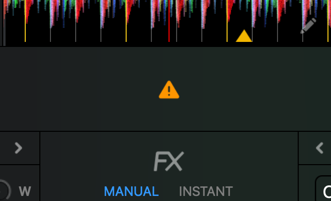
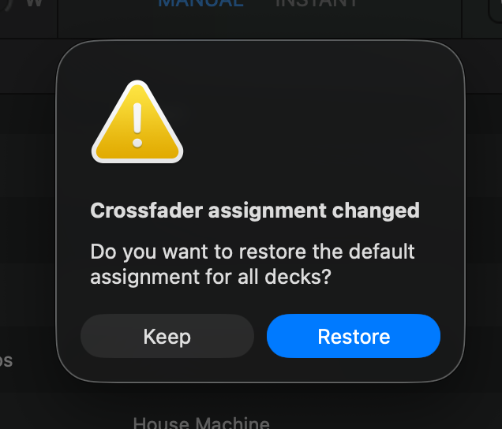
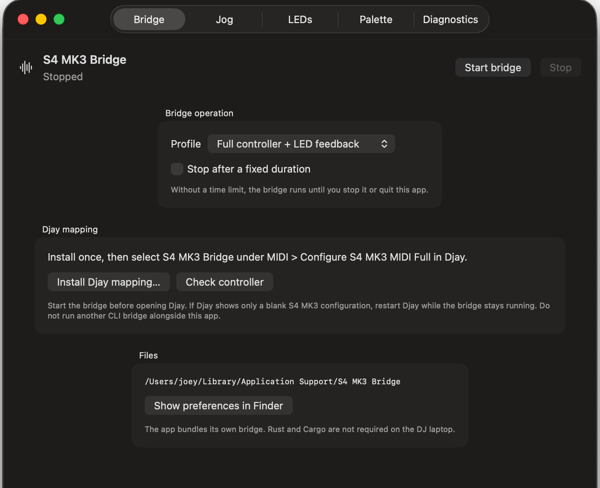
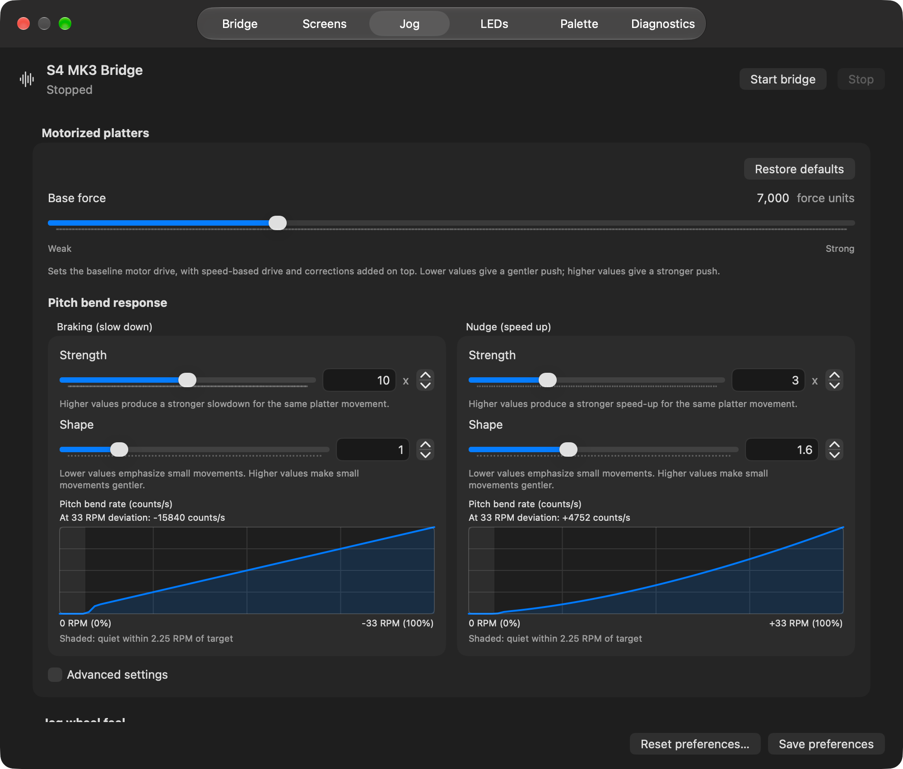

# S4 MK3 HID-MIDI Bridge

Use the Native Instruments Traktor Kontrol S4 MK3 with Djay Pro on macOS
through a menu-bar app. The bridge translates controls and drives LED feedback;
Djay sends audio directly to the S4. No development tools are needed.

**S4 MK3 Bridge** is a beta with a custom Djay mapping, not a recreation
of every Traktor feature. Read the control differences and known limitations
below before using it for a set.

**[User guide: setup, everyday workflows and mapping choices](docs/user-guide.md)**
is the maintained starting point for the current full-controller build.
It explains browsing/preview, loops and jumps, FX pickup, pads, jog feel and
screens without requiring MIDI or development knowledge.

## Requirements

- An Apple Silicon Mac running macOS 12 or later, plus a macOS version supported
  by your installed Djay Pro.
- Djay Pro with **PRO access**, which is required for custom MIDI mappings.
- A Traktor Kontrol S4 MK3, its power adapter, and a USB connection to the Mac.

Windows development builds have separate requirements and aren't release-qualified.
See [Windows setup](docs/windows/windows-setup.md); the downloads described below are
for macOS.

**Windows startup:** start the bridge and wait for **ready** before opening
Djay. If Djay is already open, the S4 LEDs can show the wrong state and TT
may not drive the platter. See the [Windows startup workaround](docs/windows/windows-setup.md#normal-startup-and-screens).

## Download and install

1. Open [GitHub Releases](../../releases) and choose the latest published release.
2. Download **`S4.MK3.Bridge-0.3.0-beta.1-arm64.dmg`**.
3. Open the disk image, drag **S4 MK3 Bridge** to **Applications**, then eject
   the disk image.
4. Open **S4 MK3 Bridge** from Applications.

**0.3.0-beta.1 (build 8)** is published for macOS, with motorized playback,
Jog tuning, EXT switching and multi-deck Instant FX. A ZIP is also available
as **`S4.MK3.Bridge-arm64.zip`**. See the
[illustrated release notes](docs/releases/notes/release-0.3.0-beta.1.md).
Use the app and mapping supplied together, including for screens, startup
channel synchronization and FX pickup.

The app is ad-hoc signed, not Developer ID signed or notarized. macOS may block
the first launch because it can't verify the developer. After attempting to
open it, go to **System Settings > Privacy & Security** and choose **Open Anyway**,
then confirm **Open**. On macOS 12, use **System Preferences > Security & Privacy >
General** instead. Approve it only if you trust the download; there's no need
to disable Gatekeeper.

## First start, mapping, and audio

1. Connect and power on the S4. Run only one bridge instance.
2. Open the app's Settings from its menu-bar icon. Settings opens automatically
   on first launch; **Check controller** can help confirm the connection.
3. Select the **full-controller profile**, choose continuous operation, and
   click **Start bridge**.
4. Choose **Install Djay mapping…**, save the mapping, and accept Djay's import.
   If necessary, open the saved `.djayMidiMapping` file in Djay.
5. In Djay, enable **S4 MK3 MIDI Full** and select **S4 MK3 Bridge** as its
   mapping. Repeated imports may add a number to the name. Use the four-deck
   layout to access decks A, B, C, and D.
6. In Djay's audio settings, select the **S4's native audio device** and configure
   Main and Pre-cue outputs for the speakers and headphones. Audio goes directly
   between Djay and the S4, not through the bridge. Master, booth, headphone
   level, and headphone mix controls remain hardware-local.
7. **EXT external inputs require DVS to be turned on in Djay.** Open
   **Settings > DVS**, check **Enable Digital Vinyl Control**, and assign
   the S4 inputs to the decks: Deck 1 **1-2**, Deck 2 **3-4**, Deck 3 **5-6**,
   Deck 4 **7-8**. Apply the assignments and leave DVS enabled.
   EXT does not turn it on automatically. See the
   [illustrated DVS setup](docs/user-guide.md#required-djay-dvs-setup).

**Expected THRU warning:** when a crossfader assignment switch is set to
**THRU**, Djay may show a warning triangle. Clicking it opens **"Crossfader
assignment changed"** and asks whether to restore the default assignment for
all decks. This is expected: THRU intentionally lets that channel bypass the
crossfader. This specific warning does not mean the bridge or mapping is
broken. Choose **Keep** to retain your switch assignments; **Restore** resets
them to Djay's defaults.

On macOS, if Djay shows only a blank S4 configuration, restart Djay with the
bridge already running. After reconnecting Djay or reselecting its mapping, use
**Stop bridge**, then **Start bridge** to refresh crossfader assignment and curve
initialization. This is separate from the Windows BLOOP startup race above;
Stop/Start isn't a verified recovery for missing Windows startup feedback.

When updating, install and select the mapping from the new app. Save it under
a new filename and keep any custom mappings under their existing names.
Restarting the bridge alone doesn't update Djay's mapping.

Closing Settings leaves the app running in the menu bar. Use **Stop bridge**
to stop control translation, or **Quit S4 MK3 Bridge** to quit.

_Bridge controls and mapping installation._

## Controls and differences from Traktor

This section and the [user guide](docs/user-guide.md) describe the published
macOS **0.3.0-beta.1** app and its matching mapping. Windows development
trials have separate setup and acceptance limits.

The full profile supports mixer EXT buttons for per-deck THRU/Internal
switching, with indicators from Djay's actual THRU state. Switching and lamps
are confirmed on all four channels; see the
[EXT validation record](docs/validation/controls/ext-input-validation.md).

**Motorized playback remains experimental.** TT enables it independently of
Vinyl; JOG toggles Vinyl red/on and blue/off. Normal mode starts with Vinyl on,
TT with Vinyl off. With TT Vinyl off, braking bends the track down and hands
off to Scratch at low speed; forward nudges use pitch bend. Moving a paused
TT platter can scratch without enabling Vinyl. Jog settings provide Base
force and separate Braking/Nudge Strength and Shape controls.
Diagnostics shows physical RPM, MIDI bend output and routing mode, not
measured audible playback speed. Physical response across setups and Djay's
audible slowdown limit remain unverified. See
[motorized playback and tuning](docs/user-guide.md#testing-motorized-playback).
**Turn TT off or Stop bridge before quitting Djay:** its last reported
playing state can remain active after Djay closes.

The mapping covers four-deck transport, touch scratching and pitch bending,
mixing, EQ, headphone cue, loops, browsing, hotcues, samples, Neural Mix, and
effects. A/C and B/D select the deck controlled by each side. Software feedback
drives button and pad LEDs, channel meters, and jog-ring decoration.

TT stays red, with brightness indicating
selection. Channel ON independently arms/disarms decks for mixer Instant FX,
so one held effect can apply to several tracks together. Only A starts armed.

These are intentional custom mappings. Djay's loop, Neural Mix, and effect
models differ from Traktor's, so the same labels don't always mean the same
thing.

| Control                            | Behavior in this bridge                                                                                                                                                                                                               |
| ---------------------------------- | ------------------------------------------------------------------------------------------------------------------------------------------------------------------------------------------------------------------------------------- |
| **LOOP turn / press**              | Select loop size / toggle the loop. Loop size is independent of MOVE's jump length, unlike Traktor's shared length.                                                                                                                   |
| **MOVE turn**                      | Jump by the selected jump length, or move the active loop by that length. Each deck keeps its own loop and jump sizes.                                                                                                                |
| **MOVE press**                     | Toggle jump-size selection. Turn MOVE to change the size immediately; press again to exit. The selected deck's selector pulses while selecting. The mode survives deck switches, has no timeout, and clears when the bridge restarts. |
| **Shift+MOVE turn**                | Jump one beat per step in either direction, even during size selection, then restore the last confirmed jump length. |
| **Shift+LOOP turn / press**        | Move the loop region / reloop the stored loop range. Manual loop in/out isn't mapped. These replace Traktor's shifted key/quantize functions.                                                                                         |
| **REV**                            | Reverse only while held. Release ends reverse. It doesn't automatically enable Slip as Traktor enables Flux; use FLUX to control Slip independently.                                                                                  |
| **Sync / Shift+Sync**              | Normal Sync is deck-specific. Shift+Sync on either side cycles Djay's tempo-fader range **globally for all decks**, rather than locking one deck's tempo fader as in Traktor. Djay determines the ranges and their order.             |
| **Channel FX1 / FX2**              | Choose the deck controlled by the left / right FX strip. These are per-deck control targets, not Traktor's shared FX buses or audio-routing assignments.                                                                              |
| **FX strips**                      | Control three manual effects on the target deck. Shift + parameter knob browses previous/next effects; release Shift for parameter pickup. Shift + effect button retains next-effect selection. See the bank-enable limitation below. |
| **Channel ON and mixer FX**        | ON independently arms/disarms each deck; held mixer FX apply to all armed decks. ON is white for normal EQ, cyan for Neural Mix EQ, and brighter when armed. An active Instant FX overrides that deck's ON with its effect-button color. |
| **Filter, then channel ON**        | Filter flashes cyan awaiting a deck; the next ON toggles only that deck's Neural Mix EQ without changing the Instant FX target. Filter again cancels. Idle Filter is dim cyan; it no longer resets a filter. |
| **STEMS / MUTE**                   | STEMS selects the Neural Mix mute/solo pads; Shift with pads 1-4 gives exclusive solo. Current macOS source builds with the matching mapping use either MUTE button to toggle global Mute/Solo Echo Out. Published older builds and Windows keep MUTE as a STEMS alias. |
| **REC**                            | Assigned to Djay's Record Sample action. Algoriddim has confirmed a bug with this action; a fix and retest are pending. It is not the set recorder. |
| **Shift+CUE**                      | Jump to the beginning of the song, not the saved start cue. Normal CUE is unchanged. |
| **Playlist / Star buttons**        | Playlist marks/unmarks selected songs; Star switches the library table. |
| **Preview**                        | Hold to preview; turn BROWSER while holding to scrub, then release to stop. Without Preview or Shift, BROWSER browses tracks. If preview gets out of sync with the hold, close it with the mouse. |
| **Shift+BROWSER turn**              | Select the next/previous library source. Holding Preview still scrubs instead, including with Shift held. |

HOTCUE pads trigger eight hotcues; Shift clears them. SAMPLES pads play
samples; Shift stops them. A/C share sampler bank 1, and B/D share bank 2.
Neural Mix availability depends on the track and Djay support.

**The macOS app includes S4 screen support.** Enable it in the **Screens** tab
or with **Enable S4 screens** in the menu bar. HOTCUE and SAMPLES show JUMP,
active LOOP size, KEY and tempo RANGE; STEMS shows the reactive mute/solo
legend. Install the mapping from the same app under a new filename, preserving
custom mappings; older mappings lack numeric screen feedback.
The [screen-driver controls](docs/guides/screen-driver-handover.md) can temporarily
stop NIHardwareAgent with confirmation and restore it afterward. Manual recovery
remains available even with screen support off.
Haptic cues remain unsupported. Motor-assisted wheel tension is available in
the full-controller profile as described below. Normal jog rings advance with
playback, follow Scratch and hold on pause; TT rings follow physical wheel
rotation. Neither is an absolute track playhead.

### Startup positions and FX pickup

The full profile applies all four channel-volume faders and high/mid/low EQ
positions once Djay's mapping is ready. Gain, filter, crossfader position and
tempo are not applied by this startup synchronization.

Shared FX knobs keep Djay's values until you move through their pickup positions.
A mismatched knob blinks its FX button; dry/wet uses the strip's main ON button.
With screens enabled, `FX SYNC` identifies the affected deck, left/right strip,
knobs 1-3 and `W` for dry/wet. A `?` means feedback is unavailable.
See
[setup and operation](docs/guides/controls-state-sync.md).

## App settings

### LEDs and palette

Settings includes deck, stem, and hotcue colors; lamp brightness; loop and
tempo-center indicators; jog-ring appearance; and channel-meter
appearance. LED settings can be imported or exported.
Choose **Save and restart** to apply LED changes. A mapping export isn't needed.
Saved LED preferences are preserved across app updates.

The eight selectable Djay hotcue colors are supported: red, orange, blue, yellow,
green, azalea, cyan, and purple. White isn't offered in Djay's hotcue picker;
its separate fallback hasn't been verified.

### Jog wheels

The **Jog > Jog wheel feel** section has a shared **Wheel tension** slider:

- **Assist (-100 to -1):** assists each wheel's own movement while its metal
  top is touched.
- **Neutral (0):** no added tension.
- **Brake (1 to 100):** resists each wheel's movement, including after release.

The app defaults to **-77**, toward Assist. Both wheels share
the saved setting but respond independently. Channel 1's
fader remains a normal mixer control. This setting applies only to the
full-controller profile: use **Save preferences** before starting, or
**Save and restart** while running. It does **not** require a new Djay mapping.
Stop and Quit clear force; reopening restores the saved value without starting
the bridge. After a USB disconnect, reconnect and explicitly start the bridge.

Brief controller-input gaps no longer close the bridge. Tension clears while
readings are missing and returns automatically after fresh readings and new
wheel movement; Stop/Start is not required. The 50 ms cutoff and touch rules
remain in place. Physical timeout-recovery testing is still pending; see
[timeout recovery](docs/validation/jog/tension-timeout-recovery.md).

#### Djay scratch and pitch-bend response

The scratch and pitch-bend mapping controls set Speed and Reaction for all
four decks. The calibrated defaults are:

| Action                   | Speed | Reaction |
| ------------------------ | ----: | -------: |
| Scratch while touching   |  2.7% |     150% |
| Pitch bend without touch |  2.7% |      17% |

Save your preferences, then use **Install Djay mapping…** to export a new
mapping and select it in Djay. Export uses the current editor values and can
run while the bridge is running. **Saving or restarting alone doesn't apply
jog mapping changes.** Keep existing custom mappings under their original names.

Speed and Reaction adjust Djay's response, independently of hardware tension.

#### Backspins

A sharp backward flick during Scratch can continue scratching after you
release the platter, following its remaining real movement. Catching or stopping
the wheel ends the backspin.

In **Jog > Backspin**, adjust the detection threshold, extra scratch speed
and **Motor assist strength**. Defaults are **5.2%** extra scratch speed and
motor assistance **on at 100%**. Software speed and motor help are independent
of your normal scratch response and Jog Wheel Tension. Motor help fades out
within one second after release in Normal mode. TT uses its own motor control.

Use **Save and restart** to apply changes. No mapping export is needed for
backspin options, and upgrading preserves explicit saved choices. See the
[Backspin guide](docs/user-guide.md#backspin-detection) for tuning and details.

_Jog settings in 0.3.0-beta.1, with motor strength and response
controls visible together. See the [user guide](docs/user-guide.md#testing-motorized-playback)._

The menu-bar icon turns green while the bridge is running;
it turns red if requested screens are blocked or fail while the bridge keeps
running. **Diagnostics** shows the app release and build number alongside the
bridge log.

## Known issues and limitations

See the [current issue checklist](docs/issues.md) for detailed limitations
and remaining checks.

Open bugs and unresolved behavior:

- **Windows BLOOP startup race (Direct HID and NI Bridge, full profile):**
  Djay can send its initial deck state after the MIDI endpoint appears but
  before the bridge starts listening. The bridge can say **ready** while the
  LEDs disagree with Djay and TT lacks the feedback it needs to drive the
  platter. **Leave TT off and fully quit and reopen Djay while the bridge
  stays ready.** Save the log and any existing MIDI capture if reporting
  the issue. An earlier listener narrowed the race, but did not fix it.
  See the [issue and evidence](docs/issues.md#open-windows-bloop-startup-feedback).
- **Sensor-time safety exit:** reversed wheel-sensor time stops the bridge.
  Keep the exact Diagnostics error if this occurs; it is separate from the
  automatically recovering 50 ms input-gap path.
- **FX bank enable:** the leftmost FX button duplicates slot 1. Whole-bank
  bypass that preserves individual slot states remains unresolved.
- **REC / Record Sample:** Algoriddim confirmed a Djay bug. An upstream fix
  and successful retest are pending; REC's mapping is established and isn't
  the set recorder.
- **macOS mapping reconnect/reselection:** automatic detection isn't
  implemented. Stop and start the bridge after either event to reinitialize
  startup state. This doesn't resolve the Windows startup race above.
- **Rapid MOVE bursts:** Djay can coalesce zero-delay jump commands; see the
  [reproduction](docs/validation/controls/controls-state-sync-validation.md#native-burst-limitation).
- **Deck-selector contrast:** selected versus unselected buttons can be hard
  to distinguish in dark venues; investigation remains pending.

Validation limits:

- **Windows EXT inputs require ASIO:** install the S4 MK3's ASIO audio driver
  before enabling DVS in Djay Pro. EXT switches a deck to **THRU**; it
  cannot enable DVS for you. See [Windows EXT setup](docs/windows/windows-setup.md#ext-inputs-and-dvs).
- **External audio:** the broader input-mixing blocker is closed. Channel 4
  fader, FX and mix/cue operation, all four USB input assignments, and all
  four EXT switches and lamps are confirmed. This doesn't establish every
  mixer control, phono gain/staging or four simultaneous sources. Enable DVS
  and assign inputs manually; unknown feedback means no EXT switch and a dark
  lamp. Shift+EXT retains hardware input-type selection. See the
  [external-audio evidence](docs/validation/controls/external-input-routing-test.md#subsequent-bridge-active-confirmation)
  and [workflow](docs/user-guide.md#external-audio-through-a-deck).
- **Jog rings and motors:** normal playback/Scratch/pause continuity and TT
  physical tracking are implemented. Extended testing and exhaustive fault
  recovery remain incomplete; see the
  [ring validation](docs/validation/feedback/tt-normal-ring-recovery-validation.md).
  Physical input-timeout recovery also remains unverified as noted above.

Independent loop/jump sizes, global Shift+Sync, per-deck FX targeting, and REV
without automatic Slip are design choices, not outstanding fixes.

## Roadmap

- Resolve the Windows startup race and complete Windows release qualification.
- Continue motorized playback, jog-ring and fault-recovery testing; investigate
  FX bank bypass, rapid jump bursts and deck-selector contrast, and retest REC
  after an upstream fix.
- Linked loop/jump sizes, new haptics, additional screen pages and pad
  legends, and an on-controller settings gesture remain deferred.
- Explore a standalone hardware bridge longer term, along with other DJ
  applications and simpler guest setup. These aren't features of this beta.

## Beta feedback

Report problems through the repository's Issues tab. Include the app version,
macOS and Djay versions, selected mapping name, deck and modifier/pad mode,
steps to reproduce, and expected versus actual behavior. For jog or LED
problems, a short video helps. Include relevant app **Diagnostics** output,
checking it for private information before sharing.

## Thanks

Thanks to RufusIbiza, maintainer of [Encdr](https://github.com/RufusIbiza/Encdr),
for the S4 MK3 protocol documentation and controller support this bridge builds on.

## Developer and reference documentation

- [Documentation index](docs/README.md)
- [User guide and everyday workflows](docs/user-guide.md)
- [macOS app, packaging, and developer checks](macos/README.md)
- [Full mapping layout and test records](docs/reference/full-midi-test.md)
- [Settings and control tuning](docs/guides/configurable-controls.md)
- [Current issue checklist](docs/issues.md)
- [Traktor comparison and historical evidence](docs/research/djay/traktor-djay-comparison.md)
- [Djay action reference](docs/reference/djay-action-reference.md)
- [Bridge function reference](docs/reference/bridge-function-reference.md)
- [LED feedback](docs/guides/led-feedback.md)
- [Standalone hardware research and board shortlist](docs/research/hardware/hardware-bridge-research.md)
- [Design history](docs/research/design/design.md)
