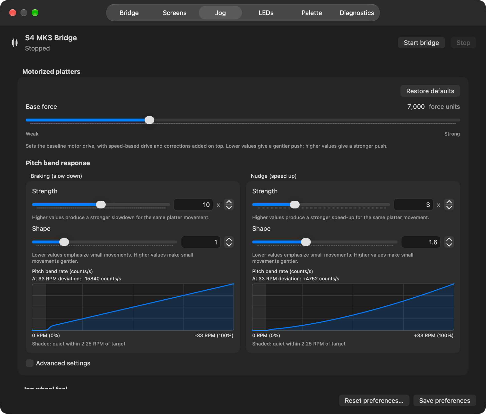
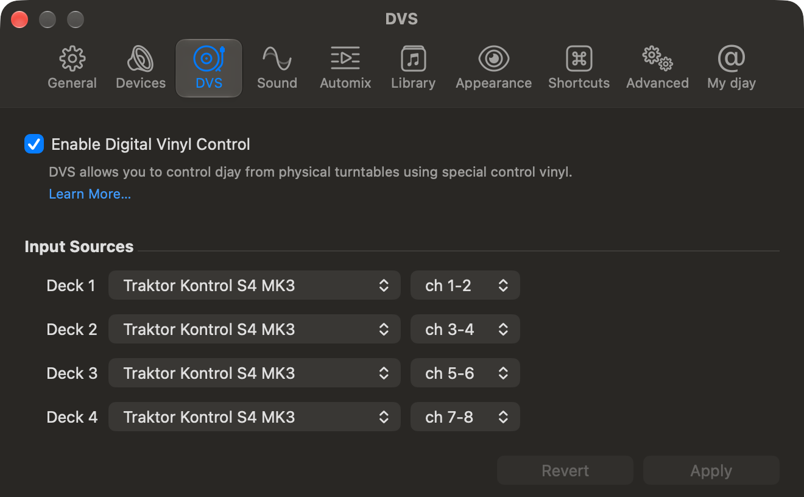

# S4 MK3 Bridge 0.3.0-beta.1

Motorized platters come to Djay Pro, with separate braking and nudge controls,
a simpler Jog settings page, external-input switching, and Instant FX on
several decks at once.

## Motorized playback with TT

Install this release's mapping and select **Internal / INT** for a loaded
deck in Djay. Press **TT** on either side to enable motorized playback for
the deck selected on that side. Start the track and the platter rotates at
the default **33 RPM**; pause the track
or turn TT off to stop powered rotation. TT starts off each time you start
the bridge, so normal jog operation remains available.

**TT and Vinyl are separate controls.** JOG switches touch scratching on or
off: red means Vinyl on, blue means off. Normal mode starts with Vinyl on;
motorized mode starts with Vinyl off. Each mode remembers its own choice
during the session. TT stays red and becomes brighter when enabled.

- With Vinyl off, slow the platter to bend the track down, or push it forward
  to nudge the track faster. At very low speed, it changes to scratching so
  you can stop and reverse the track.
- With Vinyl on, touching the top selects scratching directly.
- With playback paused, moving the platter can scratch even with Vinyl off;
  the motor stays neutral.
- To seek in TT mode, hold **Shift first**, then touch and turn the platter.

Let the wheel settle near its target speed before bending. Small movements
within 2.25 RPM of target are ignored to avoid unwanted pitch changes.

This beta also refines touch release, stop/reverse transitions, backspins and
motor assistance, and reduces unwanted correction during steady playback.
Motorized playback remains experimental: platter motion is not a guarantee
of exact audible track speed, and this is not a claim of Traktor-equivalent feel.

**Turn TT off or Stop bridge before quitting Djay.** Closing Djay alone can
leave its last reported playing state active.

## Easier Jog tuning

Open **Settings > Jog**. The controls most useful for feel are at the top:

- **Base force** sets the baseline motor push, from Weak to Strong.
- **Braking** adjusts how strongly slowing the platter slows the track.
- **Nudge** adjusts how strongly pushing it forward speeds the track up.
- **Strength** changes the amount of response. **Shape** changes how gentle
  small movements feel. Higher Shape values soften small movements.

*Base force and both response controls stay visible. The curves preview the
commands sent to Djay, not a measurement of the sound.*

Tick **Advanced settings** for target speed, Vinyl startup choices, the
low-speed switch to scratching, and detailed motor settings. Each control has
its own explanation. **Restore defaults** resets only the Motorized platters
group in the editor; it leaves wheel tension, Backspin and mapping settings
alone. Save afterward to apply it.

The new starting values include Base force **7,000**, braking **10x / Shape 1**,
nudge **3x / Shape 1.6**, and wheel tension **-77**, toward Assist. The extra
scratch speed for detected backspins is now **5.2%**.

**Upgrading keeps your saved choices.** To try the new motorized defaults,
choose Restore defaults, then **Save and restart** if the bridge is running,
or **Save preferences** before starting. That button does not reset wheel
tension or Backspin; change those separately if wanted.

The unused absolute platter sensitivity setting has been removed. Ordinary
touch scratching and the motorized controls remain available.

## Switch external audio with EXT

The mixer **EXT 1-4** buttons now switch their corresponding Djay decks
between **Internal** playback and external-audio **THRU**, regardless of
which deck is selected on the jog side. The EXT light follows Djay's reported
THRU state. **Shift+EXT** retains the S4's hardware input-type selection.

Before using EXT, open **Djay Settings > DVS**, enable **Digital Vinyl Control**,
and assign the S4 input pairs to Decks 1-4: **1-2, 3-4, 5-6, 7-8**.
Leave DVS enabled. EXT does not turn it on for you.

*Enable DVS and assign inputs first. An EXT light confirms THRU mode, not
that the audio routing is ready.*

Connect the source, select its input type with Shift+EXT, then press the
channel's EXT button without Shift to use THRU. Press again to return to the
loaded track. See the [external-audio walkthrough](https://github.com/jtoronto/S4MK3-HID-MIDI-BRIDGE/blob/main/docs/user-guide.md#external-audio-through-a-deck)
for the input types and a step-by-step example.

## Instant FX on more than one deck

Channel **ON** now independently arms or disarms each deck for mixer Instant
FX. Arm A and B, for example, to apply one held mixer effect to both tracks.
Only A starts armed.

This is separate from the left/right FX-strip targets. To change normal EQ
versus Neural Mix EQ, press **Filter**, then the channel's **ON**, as before.
An ordinary ON press is not a channel mute.

## Less app overhead and clearer diagnostics

Settings and Diagnostics now avoid unnecessary interface updates, including
when Settings is hidden. This reduces native-app CPU use without stopping
the incoming telemetry.

Diagnostics shows each side's physical platter RPM, bend output and current
mode, helping distinguish bending, scratching, seeking and waiting states.
These are controller/bridge readings, not an audio-speed measurement.

The [user guide](https://github.com/jtoronto/S4MK3-HID-MIDI-BRIDGE/blob/main/docs/user-guide.md)
has also been rewritten around everyday workflows, with clearer setup,
control explanations and troubleshooting.

## Updating

1. Turn TT off, stop the bridge and quit the old app.
2. Open **S4 MK3 Bridge-0.3.0-beta.1-arm64.dmg** and replace the app in
   **Applications**, or use the ZIP. Your saved preferences are preserved.
3. Open the new app. Diagnostics should show **0.3.0-beta.1 (build 8)**.
4. Choose **Install Djay mapping...**, save under a new name to preserve
   custom mappings, import it and select it in Djay.
5. Start the bridge. If you changed mappings while running, stop and start
   it again.

**Install the new mapping for this release.** It includes external-input
switching and the feedback needed for motorized playback. Restarting alone
does not update the mapping. Later motor-force and response changes use
Save and restart; they do not need another mapping export.

Requires an Apple Silicon Mac, macOS 12 or later, Djay Pro with PRO access,
and a powered S4 MK3. Rust and Cargo are not needed on the DJ laptop.
The app is ad-hoc signed, not notarized; use the
[first-launch instructions](https://github.com/jtoronto/S4MK3-HID-MIDI-BRIDGE/blob/main/README.md#download-and-install)
if macOS blocks it.

## Still a beta

Motorized playback needs further hardware/audio validation across setups.
Software and package checks do not establish exact playback-speed accuracy.
Try it before relying on it for a set.

The main FX-strip ON button still duplicates slot 1 rather than bypassing
the whole bank. Screens do not show artwork, waveforms or track titles.
A USB disconnect or wheel sensor-time error can still stop the bridge.
