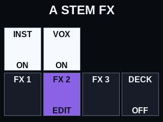
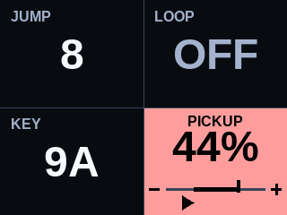

# S4 MK3 Bridge 0.4.0-beta.1

## Windows x64 support

This beta brings the S4 MK3 Bridge to Windows x64.

Windows requires the Microsoft Basic Loopback 1.0 transport (BLOOP). It is not part of a standard Windows installation but will be included in a future Windows update. In the interim:

- install the official preview build available [here](https://github.com/microsoft/MIDI/releases/tag/inbox-preview-14).

- Scroll all the way down to Assets, and download and install
  `Windows.MIDI.Services.Transports.1.0.52-preview.14-x64.exe`.
- You don't need to install the tools, but they do include some pretty cool stuff/toys.

## Two different methods of controlling the screens/motors

While the Mac version is able to disable the NIHardwareService and control the screens and motors directly, this was not possible on Windows. Controlling the screens and motors simultaneously was not possible due to interference from the NIHardwareService. Rather than fight it, it was discovered after a bit of reverse engineering that it's possible to use the NIHardwareSerice to do whatever you want.

This allowed simultaneous screen/motor usage on Windows, with the added benefit that the motors driving the NI service feels exactly like Traktor, including better backspin behavior.

I decided to bring this option to the Mac version too.

## Choose your controller mode

- **Direct HID:** keep the bridge's adjustable motor feel. On Mac, you can run the screens and motors together. On Windows the screens stay off in this mode.
- **NI Bridge:** let the Native Instruments service drive both platters and screens. Adjust **NI jog wheel tension** live for both wheels. Vinyl startup choices, backspin detection, and scratch and pitch bend mapping remain available.

Stop the bridge before changing modes. Leave the NI service running in NI Bridge mode.

## New performance controls

- **Stem FX:** press **STEMS** twice from HOTCUE or SAMPLES. Use pads **5–7** to select a manual effect and pads **1–4** to choose its stems. Pad **8** returns the effect to the whole deck.

  

- **Mute/Solo Echo Out:** either **MUTE** button switches Djay's echo setting on or off without changing the pads.
- **Tempo pickup:** a red tempo-center light means the fader and Djay disagree. Move the fader and follow the screen arrow to the target. The percentage is the distance left to move, not a BPM change.

  

## Installing or upgrading

Use the package and mapping for your computer. On Mac, open the arm64 DMG and drag the app to Applications. On Windows, follow the [Windows setup instructions](../../user-guide.md#windows-setup) for Windows MIDI Services Basic Loopback and the NI driver. Start the bridge and wait for **ready** before opening Djay on Windows.

Choose **Install Djay mapping…** and keep custom mappings under their original names. In Djay select **S4 MK3 MIDI Full** on Mac or **S4 MK3 Bridge BLOOP** on Windows. Restarting alone does not install the new stem and tempo controls.

**Before a set:** check Play and headphone cue lights against Djay. If initial feedback is missing on Windows, leave TT off and reopen Djay while the bridge stays ready. On both platforms turn TT off or stop the bridge before quitting Djay. See the [illustrated user guide](../../user-guide.md) and [known issues](../../../README.md#known-issues-and-limitations).
