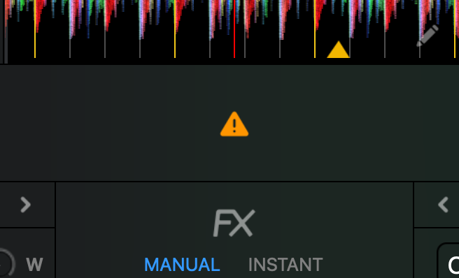
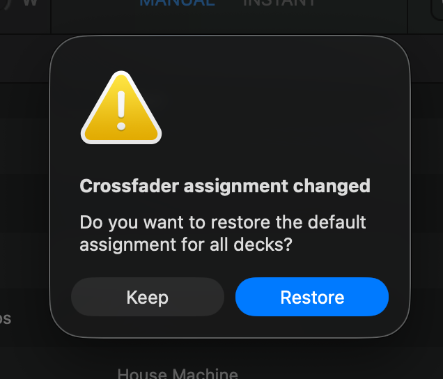
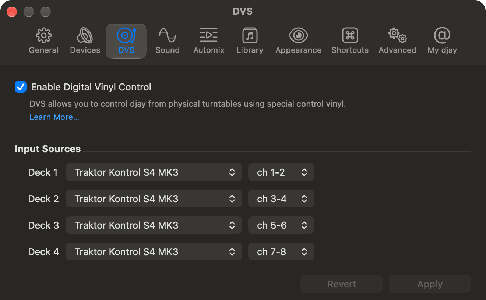
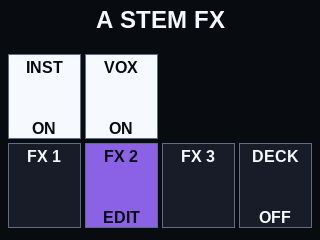
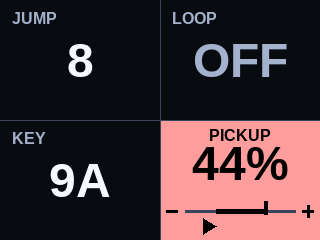

# S4 MK3 Bridge user guide

Use this guide to DJ with the S4 MK3, understand the custom mappings, and
recognize what its lights and screens are telling you.

This guide describes the full-controller app. Features and available downloads
vary by version and platform; check your package's release notes. Always use
the app and its matching mapping together, importing updates under a new name
to preserve custom mappings.

## Contents

- [One-time setup](#one-time-setup)
  - [Windows setup](#windows-setup)
- [Start and finish a set](#start-and-finish-a-set)
- [Deck focus and transport](#deck-focus-and-transport)
- [Browse, preview and load](#browse-preview-and-load)
- [Loops and beat jumps](#loops-and-beat-jumps)
- [Mixing, cueing and Neural Mix EQ](#mixing-cueing-and-neural-mix-eq)
- [Manual FX strips](#manual-fx-strips)
- [Mixer Instant FX](#mixer-instant-fx)
- [Pads and sample banks](#pads-and-sample-banks)
- [Jog wheels and feel](#jog-wheels-and-feel)
  - [Testing motorized playback](#testing-motorized-playback)
- [Screens and feedback](#screens-and-feedback)
- [Settings: what needs saving or a new mapping?](#settings-what-needs-saving-or-a-new-mapping)
- [Troubleshooting](#troubleshooting)
- [Intentional differences and limits](#intentional-differences-and-limits)

## One-time setup

You need Djay Pro with Djay PRO access for custom MIDI mappings, and the
powered S4 MK3 connected by USB. Use one bridge instance at a time. The bridge
handles controls, not audio: in Djay, select the S4's audio interface and
route **Main** to your speakers and **Pre-cue** to your headphones.

### macOS setup

1. On an Apple Silicon Mac, [install the app](../README.md#download-and-install)
   and open it. Quit any older bridge instance first.
2. In Settings, select **Full controller + LED feedback** and turn off
   **Stop after a fixed duration** for normal DJ use.
3. Choose a bridge mode while stopped and click **Start bridge**. Follow the
   screen instructions below if you want to use the displays.
4. Choose **Install Djay mapping...**, save under a new filename and complete
   Djay's import. Preserve your existing custom mappings.
5. In Djay, open **MIDI > Configure S4 MK3 MIDI Full**, enable the device and
   select the imported **S4 MK3 Bridge** configuration. Its name may have a
   number appended.
6. Stop and start the bridge after selecting a different mapping. Confirm
   controls and headphone cue before using the speakers.

### Windows setup

Use **Windows 11 25H2 or later on an x64 PC**. Both bridge modes require
Windows MIDI Services with **Basic Loopback (BLOOP)**. If Basic Loopback is
unavailable:

1. Close all MIDI apps. Follow Microsoft's
   [Preview 14 installation instructions](https://github.com/microsoft/MIDI/releases/tag/inbox-preview-14),
   including removal of older preview components where directed.
2. Install the tested
   [Preview 14 x64 Transports installer](https://github.com/microsoft/MIDI/releases/download/inbox-preview-14/Windows.MIDI.Services.Transports.1.0.52-preview.14-x64.exe).
3. Reopen the bridge and check Basic Loopback again. The bridge does not
   install it or switch to another MIDI connection automatically.

LoopBe1, loopMIDI and a separate connection-creation utility are not required.
The bridge creates **S4 MK3 Bridge BLOOP** when it starts and removes its
connection after it stops.

For **NI Bridge**, install Traktor first to provide the controller driver
and **NIHardwareService**. Close Traktor while using Djay, but leave
NIHardwareService running. An audio driver alone does not establish that the
service is installed; the standalone driver's service support has not been
verified. **Direct HID** does not require NIHardwareService. For external
audio through DVS, install the **S4 MK3 ASIO audio driver** as well.

On the project's **Releases** page, choose a Windows x64 download:

- **Setup.exe:** Run the supplied `...-win-x64-Setup.exe` to install for
  your Windows user, then open **S4 MK3 Bridge** from Start. The installer
  does not install Djay, NI software or Windows MIDI Services.
- **ZIP:** Extract the entire archive into a folder and open `S4Bridge.exe`.
  Keep its files together.

Both formats use the same preferences on that PC; the ZIP does not carry
settings to another computer. To update, stop and quit the bridge first.
To remove the installed app, use **Settings > Apps > Installed apps**; to
remove a portable copy, stop and quit it before deleting its folder.
Neither removal deletes your preferences or Djay mappings.

Set up and start the bridge:

1. Connect and power the S4. Close Djay, Traktor and any other bridge instance.
   In **Bridge**, choose **Direct HID** or **NI Bridge** while stopped.
   Select the **full** profile for Direct HID; NI Bridge uses full.
2. Start the bridge and wait for **Bridge: ready**. Starting the bridge
   creates **S4 MK3 Bridge BLOOP**.
3. Choose **Install Djay mapping...** and complete the import in Djay. In
   Djay's MIDI settings, select the imported Windows mapping for **S4 MK3
   Bridge BLOOP**. Use the mapping generated by this Windows app, not a Mac
   or older LoopBe mapping. Keep custom mappings under their existing names;
   for manual export, choose a new filename.
4. Check playback and headphone cue lights against Djay. **Bridge: ready**
   confirms the connection, not that Djay has sent feedback. If initial
   feedback is missing, save the diagnostics, then fully quit and reopen
   Djay while the bridge remains ready. Do not rely on switching mappings
   to refresh it.
5. In NI Bridge, check **Screens: active** and the actual displays. Confirm
   controls and headphone cue before using the speakers.

### Choose a mode and set up screens

Stop the bridge before changing modes. Availability varies by app version.

| Mode | macOS | Windows |
| --- | --- | --- |
| **Direct HID** | Optional screens and adjustable motor settings. Enable **S4 screens** in Settings > Screens. | Adjustable motor settings; screens are not available. |
| **NI Bridge** | Screens and platters use the NI service together. Leave it running; there is no separate screen toggle. | Screens and platters use the NI service together. Leave it running; there is no separate screen toggle. |

In **NI Bridge**, check that the screens are active and showing the expected
page. In **Jog**, **NI jog wheel tension** adjusts both wheels live; Direct
HID's tension and motor settings are separate. Windows NI Bridge requires the
service described in [Windows setup](#windows-setup).

If Djay offers only a blank S4 configuration, restart Djay with the bridge
already running, then select the imported mapping.

### macOS Direct HID screen handover

If NI's background screen driver is running, the app offers **Enable screens**,
**Continue without screens**, or **Cancel**. Enable screens temporarily stops
that driver. Optional automatic stopping and restoration are in the Screens
tab. Close Traktor, Maschine and Komplete Kontrol before handing over their
shared service; the bridge will not close those applications for you.

Continue without screens still runs controls, LEDs and saved tension. To enable
screens later, choose **Enable screens - stop NI driver** in the menu or
Screens tab. A red status icon can mean screens are blocked while controls
continue working. Use these recovery controls rather than stopping the driver
manually.
See the [screen-driver guide](guides/screen-driver-handover.md).

## Start and finish a set

### Before playing

1. Power/connect the S4 and open the bridge app.
2. Put the channel-volume faders at your intended starting positions,
   normally down for tracks you are cueing.
3. Start the full-controller bridge, then open Djay and select the matching
   mapping. On Windows, wait for **Bridge: ready** before opening Djay.
4. Check Djay's channel volumes and EQ. After mapping feedback arrives, the
   bridge applies the physical volume and high/mid/low EQ positions once.
   Do not assume that synchronization has happened before the mapping connects.
5. Check gain, filter, tempo and crossfader position separately: they are not
   included in that startup push. Crossfader assignment switches and curve
   have their own startup synchronization.
6. Cue a track through headphones, confirm the selected deck, then bring its
   channel volume into the mix.

Later mouse edits stay in place until you move the corresponding control.
Shared FX knobs use pickup instead of jumping to their physical positions.
See [startup and pickup details](guides/controls-state-sync.md).

### When finished

**Turn TT off or Stop bridge before quitting Djay.** The bridge can retain
Djay's last reported playing state after Djay closes.

Pause playback or lower your outputs, then use **Stop bridge** or
**Quit S4 MK3 Bridge**. Stopping the bridge does not pause Djay.
Closing the settings window alone leaves the app running in the macOS menu
bar or Windows system tray. On Windows, **Stop** keeps the app open;
**Quit** or the tray's **Quit S4 MK3 Bridge** stops it and exits.

In **macOS Direct HID**, stopping the bridge restores a driver the app stopped
if automatic restoration is enabled. Turning screens off alone does not
restore it during a running session. To return to Traktor, use **Restart
Native Instruments screen driver** if needed and accept **Stop bridge &
restore NI driver** if prompted. Open Traktor after restoration; restart it
if it was already open.

In **NI Bridge**, stop the bridge before returning to Traktor; leave the NI
service running. On Windows the last screen image may remain after Stop. If
release is unconfirmed, check Diagnostics rather than assuming the screens
have been released. Windows does not use the macOS stop/restore procedure.

## Deck focus and transport

| Physical side | Available decks | Djay deck numbers |
| --- | --- | --- |
| Left | A or C | 1 or 3 |
| Right | B or D | 2 or 4 |

Choose A/C or B/D before loading or working a deck. Its transport, pads,
encoders and wheel follow that focus. The four mixer channels remain assigned
to their own decks; changing the left focus to C does not turn A's channel
fader into C's.

| Control | What it does |
| --- | --- |
| PLAY | Djay play/pause |
| Deck CUE | Djay's cue/jump action, dependent on whether the deck is playing or paused |
| Shift+CUE | Jump to the beginning of the song, not the saved cue point |
| SYNC | Sync the selected deck |
| Shift+SYNC | Cycle the tempo-fader range for **all decks** |
| MASTER | Choose that deck as Djay's sync master |
| REV, held | Reverse while held; release ends reverse |
| FLUX | Toggle Djay Slip independently |
| QUANT | Send a quantize toggle to all four decks |

REV does not automatically switch Slip on or restore an earlier Slip state.
Use FLUX explicitly when you want Slip. Shift+SYNC is a global range change,
not Traktor's per-deck tempo-fader lock.
QUANT toggles each deck; it does not force already-mixed quantize states into
one uniform state.

FLX and REV are dim red when off and bright red when active. They stay dark
until Djay reports their state. Their backlights use the palette brightness
setting, like JOG. Shift is dim white and brightens while held.

## Browse, preview and load

1. Select the destination deck with A/C or B/D.
2. Turn that side's **BROWSER** to browse the library.
3. Hold **Preview** to audition the selected track.
4. While still holding Preview, turn BROWSER to scrub the preview:
   clockwise forward, counterclockwise backward. **Shift is not required.**
5. Release Preview to stop auditioning.
6. Press BROWSER to load the selection into the deck chosen on that side.

Other library controls:

| Gesture | Action |
| --- | --- |
| Shift+BROWSER turn | Next/previous library source instead of track browsing |
| Shift+BROWSER press | Library Back |
| Star button | Djay's **Switch Library Table** action |
| Playlist button | Mark/unmark the selected song; not a rating or Queue toggle |
| Library View | Toggle library visibility |

Switch Library Table changes which library table you work in; changing source
is the separate Shift+BROWSER gesture. If Preview and Shift are both held,
**Preview wins** and BROWSER still scrubs.

If Preview was already playing or becomes out of sync after a mouse edit,
stop it in Djay before trying another hold.

## Loops and beat jumps

LOOP length and MOVE jump length are independent. Each logical deck keeps its
own values in Djay.

### Set a loop

1. Turn **LOOP** to choose the loop length in Djay.
2. Press LOOP to activate it; press again to leave it.
3. While active, turning LOOP changes its size.
4. Shift+LOOP turn moves the loop region. Shift+LOOP press uses **Reloop**
   to reactivate a stored loop range.

On the S4, LOOP shows the active length with green fill, or **OFF** when no
loop is active. It does not show the preselected inactive length; look at
Djay's selector while choosing that.

### Choose a jump length and move

1. Press **MOVE** to enter jump-size selection for this deck.
2. Turn MOVE to choose the jump length. The value changes immediately in Djay.
   The deck selector pulses; the screen shows **SELECT**.
3. Press MOVE again to leave selection.
4. Turn MOVE to jump by that length. With an active loop, beat jump moves the
   loop region by the jump length.

Selection stays active across deck switches until you exit it or restart the
bridge. Restarting clears selection mode, not Djay's jump length.

For example, choose an 8-beat jump, then turn MOVE normally for 8-beat moves.
Hold Shift while turning MOVE for 1-beat adjustments, including while SELECT
is active. The bridge restores the **last confirmed** jump length afterward.

If JUMP is `?`, the previous size is not known reliably. Shift+MOVE still
selects and jumps one beat, but cannot restore an unknown size. Establish a
confirmed size first. Manual loop-in/out is not mapped.

## Mixing, cueing and Neural Mix EQ

Channel volume, gain, high/mid/low EQ and filter control the corresponding
Djay channel. Use the **small channel headphone/CUE button** for pre-cue,
not the deck's large transport CUE button. Master, booth, headphone level and
headphone mix remain hardware-local controls.

### Why Djay shows a crossfader warning

Each channel's crossfader assignment switch lets you choose a side or **THRU**.
With **THRU**, moving the crossfader won't fade that channel out. Its channel
fader still controls its volume.

Djay may show a warning triangle when you select THRU. Click the triangle
to see what changed. This warning is expected; it doesn't mean the bridge
or mapping is broken.

In **Crossfader assignment changed**, choose **Keep** to keep the assignments
you set on the S4. Choose **Restore** only if you want Djay to reset the
assignments for **all decks**, not just the channel you changed.

### Change a channel's EQ mode

1. Press the mixer **Filter** button. It flashes cyan, waiting for a deck.
2. Press that channel's **ON** button to toggle its normal/Neural Mix EQ mode.
3. To cancel without changing a deck, press Filter again.

This does not change the armed Instant FX decks. Outside this selection workflow,
channel ON independently arms/disarms that deck for Instant FX; it is not a
channel mute button.
Filter doesn't reset the software filter.

ON is white for normal EQ and cyan for Neural Mix EQ, brighter on each armed
Instant FX deck. An active Instant FX temporarily takes over its color.
Dark/unknown feedback is not proof the deck is muted.

### External audio through a deck

Djay can mix an S4 audio input through a deck in **DVS THRU** mode.

#### Required Djay DVS setup

**Turn on DVS before using EXT.** The bridge cannot enable it for you.
On Windows, install the **S4 MK3 ASIO audio driver** before enabling DVS.

1. Open Djay **Settings > DVS** and check **Enable Digital Vinyl Control**.
2. Under **Input Sources**, select **Traktor Kontrol S4 MK3** for each deck
   you want to use with an external source, using the stereo pairs below.
3. Click **Apply** after changing the assignments. Leave DVS enabled, even
   when playing normal tracks in **Internal / INT** mode.

For all four channels, configure:

| S4 input | Available source types | USB input channels |
| --- | --- | --- |
| A | PHONO / LINE | 1-2 |
| B | PHONO / LINE | 3-4 |
| C | LINE / MIC C | 5-6 |
| D | LINE / MIC D | 7-8 |

These are audio input channels, not MIDI channels. Selecting another source
type on the same S4 input does not give it a separate USB pair.

For input D, including the front MIC D socket:

1. Select the appropriate S4 input type with **Shift+EXT**: LINE for rear
   input D or MIC D for the front microphone. Keep listening levels down
   while selecting or connecting a source.
2. Start the full-controller bridge with its matching mapping selected in
   Djay, after completing the DVS setup above.
3. Press **EXT 4** without Shift to switch Deck 4 from Internal to **Thru**.
   You can also select Thru in Deck 4's **DVS control-mode
   menu beside Play**. This is different from the crossfader's THRU assignment.
4. Set channel level and cue/mix normally. If the same input is also selected
   as Djay's global Microphone, leave that microphone route off to avoid
   mixing it through a second path.
5. Once Djay reports THRU, press **EXT 4** again to choose **Internal / INT**
   and return to normal track playback, or choose Internal in the same menu.

**EXT 1-4 always address decks 1-4**, regardless of A/C, B/D or FX selection.
Each press switches between Thru and Internal using Djay's reported mode.
If that mode is unknown, the button does nothing. Check the matching mapping,
then release EXT before trying again.

Holding **either Shift** leaves EXT for hardware input-type selection.
The EXT lamp lights only when Djay reports THRU; it doesn't confirm that DVS
is enabled or audio is arriving. If you hear nothing, check **Enable Digital
Vinyl Control** and the deck's input assignment in **Settings > DVS**.

Check levels, cueing and FX before using an external source live. Full mixer
behavior across all inputs, phono behavior and four simultaneous external
sources haven't all been verified.

## Manual FX strips

The two top FX strips each control three manual effect slots on one deck.
They are **control targets**, not Traktor-style shared FX audio buses.

1. Press a channel's **FX1** button to target it from the left FX strip, or
   **FX2** for the right strip.
2. Use strip buttons **1-3** for individual effects.
3. Hold Shift on the strip's physical side and turn parameter knob 1, 2 or 3
   clockwise for next effects or counterclockwise for previous effects in that
   slot. Movement is relative, not an absolute position in the effect list.
   Shift + an effect button still chooses its next effect as a shortcut.
4. Release Shift to adjust parameters with knobs 1-3. After browsing, move
   through the software parameter's pickup position before it responds.
5. Use the shared dry/wet knob for their wet/dry amounts.

Larger turns browse several effects. These knobs have end stops: release
Shift, reposition, then hold Shift again to continue browsing.
Repositioning does not select effects, but crossing the software parameter
value picks it up and resumes parameter adjustment. Dry/wet remains a wet/dry
control even with Shift held.

Defaults are A for the left strip and B for the right. Changing A/C or B/D
deck focus does not automatically change these targets.

### Pick up a software value without a jump

After startup, retargeting or an external software edit, a physical FX knob
can disagree with Djay. Its movement is held until it reaches or crosses
the software position.

- A blinking effect button means its parameter knob needs pickup.
- A blinking strip ON means dry/wet needs pickup.
- Move toward and through the value shown in Djay until the blink stops.
- Dry/wet reaches three software slots; each picks up independently. Its
  warning clears when all three have been picked up.
- An `FX SYNC` screen header identifies the affected deck and controls.
  A `?` there means feedback is missing, not a confirmed mismatch.

After pickup, ordinary knob movement does not flash a new warning while
Djay returns the updated values. A mouse edit in Djay or a different FX
target can require pickup again.

The strip's main **ON is not a reliable whole-bank bypass**: it duplicates
slot 1. Use the individual effect buttons or Djay's UI
when you need to turn the other slots off.

## Mixer Instant FX

These are separate from the two manual FX strips:

1. Press each channel **ON** without Filter selection armed to arm that deck.
   Press again to disarm it. Several decks can be armed together.
2. Hold a mixer FX button 1-4 to apply its assigned Djay Instant FX to all armed
   decks at once.
3. Release to end the effect on every deck where that press began.

Only A starts armed. For A and B together, press B's ON; press A's ON too if
you want B alone. You can disarm all four decks: an FX press then does nothing
until you release it and make a new press with a deck armed.

Changing the armed decks during a hold affects the next FX press, not the
effect already held. Bridge Stop also releases every held effect. The central
FX button lights when Djay reports that effect active on any armed deck;
each channel's ON can still show an active effect after that deck is disarmed.
These are per-deck effects, not routing into a shared effect bus.

## Pads and sample banks

| Mode | Pads | Shift |
| --- | --- | --- |
| HOTCUE | Trigger/set hotcues 1-8 | Clear the corresponding hotcue |
| SAMPLES | Trigger sampler players | Stop their playback |
| STEMS | Pads 1-4 mute; pads 5-8 solo | Pads 1-4 exclusive solo; pads 5-8 stay ordinary solo |

A/C share sampler bank 1; B/D share bank 2. Selecting another deck on the same
physical side does not give you an independent new sample bank.

The STEMS columns are **Drums, Bass, Harmonic, Vocals**, in that order. The
lower four pads solo the same columns. Shift makes the upper row **ONLY**
so you can select one stem exclusively. On older bridge builds,
MUTE is a mode-selection alias for STEMS, not a whole-deck mute.

Neural Mix availability depends on the track and Djay support. The screen
reports actual mute/solo state; ON in a MUTE tile means that mute is active.

In current builds with the updated Djay mapping, **STEMS** still selects this
pad layer, but **either MUTE button** toggles Djay's global **Mute/Solo Echo
Out** setting without changing the pad mode. Both MUTE LEDs show bright white
when Djay reports the setting is on, dim white when it is off, and stay dark
until the state is known. Use a Djay mapping that supports Mute FX.

### Route Manual FX to stems

1. Select a deck, then press **STEMS** to open the mute/solo pads.
2. Press **STEMS** again to open **STEM FX**. The STEMS button turns purple.
3. Press pad **5, 6 or 7** to choose Manual FX slot 1, 2 or 3.
4. Press pads **1-4** to toggle the available stems for that slot, or pad
   **8** to route it to the whole deck. More than one stem can be on.
5. Press **STEMS** again to return to mute/solo.

The screen and pads follow Djay's reported routing, including changes made in
Djay. Blank stems are unavailable; `?` means the route is not yet confirmed.
If the stem layout is unknown, route pads do not send commands. Install and
select the matching new mapping for these controls and their feedback.
Windows Direct HID provides the pads and LEDs without a screen.

In either three-stem layout the screen labels are **DRUM / HARM / VOX**.
If Djay is set to Drums / Bass / Melodic, **HARM** represents Bass and
**VOX** represents Melodic. Check Djay if you are unsure which layout is active.

**REC is not the set recorder.** It uses Djay's Record Sample action, which
has a known bug. Use Djay's onscreen recording controls to record a mix.

## Jog wheels and feel

**JOG** toggles Vinyl: red enables top-touch scratching; blue keeps bend/nudge
behavior. Normal mode starts with Vinyl on, TT mode with Vinyl off. Each mode
remembers its last Vinyl choice during the session; separate startup options
are in Jog settings.

**TT** toggles motorized playback on each physical side. It starts off whenever
the bridge starts. Its lamp is red, bright when enabled and dim when disabled
(or dark if inactive lamps are set dark). See [motorized playback](#testing-motorized-playback).

Hold **Shift** and turn the jog to seek. In TT mode, hold Shift first, then
touch and turn the platter top; lifting your hand ends seeking even while the
wheel coasts. If you started a gesture before pressing Shift, release it first.
**GRID+jog** edits the beat grid instead of nudging.

### Change physical resistance

The Jog settings have different layouts for the two bridge modes:

- **NI Bridge:** **NI-managed platters** offers **NI jog wheel tension**.
  It adjusts both wheels live. Higher values increase rim resistance in JOG;
  it does not tune TT drive, braking or the Direct HID settings.
- **Direct HID:** **Jog wheel feel** provides Wheel tension, and
  **Motorized platters** provides TT force and response settings. Save and
  restart to apply these settings.

In **Direct HID > Jog > Jog wheel feel > Wheel tension**:

| Setting | Effect |
| --- | --- |
| Assist, -100 to -1 | Helps a wheel's movement while its metal top is touched |
| Neutral, 0 | No added tension |
| Brake, 1 to 100 | Resists movement, including after release |

Both wheels share the setting but respond independently. It isn't assigned to
a mixer fader or saved per deck. The app defaults to **-77**, toward Assist.
Use **Save preferences** for the next Start,
or **Save and restart** while running. No mapping export is needed.

### Change Djay's scratch/bend response

The Jog **Scratch and pitch bend mapping** section sets Djay's **Speed** and
**Reaction**. Defaults are **2.7% / 150%** for Scratch and **2.7% / 17%** for
pitch bend. **Touch-scratch direction** offers Normal or Reversed.

These change software response, not motor force. Save, use **Install Djay
mapping...**, then import and select the new mapping in Djay. Restarting alone
doesn't apply mapping changes. Haptic cue points aren't available.

### Backspin detection

In **Jog > Backspin**:

- **Detection** lets a sharp backward flick continue scratching after you lift
  your hand, following the wheel's real movement. It works during Scratch in
  Normal Vinyl mode and TT mode, including TT's low-speed Scratch with Vinyl off.
  Ordinary nudging, seeking and GRID don't trigger it.
- **Detection threshold** sets how sharp the flick must be. Raise it if
  ordinary scratches trigger backspins; lower it for easier detection. The
  default is **150000 counts/s^2**.
- **Extra scratch speed** adds speed during a detected backspin. The default
  is **5.2%**; **0%** keeps normal scratch travel. Keep normal Scratch speed
  matched to the mapping selected in Djay.
- **Motor assistance** in Direct HID helps the wheel during detected backspins in Normal
  mode only. It defaults on at **100% strength**. Lower the strength for less
  help, or use 0% or turn it off for none. TT uses its own playback assistance.

The screen shows **BACKSPIN** and the affected deck. After release, motor
assistance fades out within one second, but scratching can continue while the
wheel coasts. Retouching, stopping or reversing the wheel ends the backspin.
A top-touch backspin stays with its original deck if you change focus. A TT
Vinyl-off backspin cancels on a deck switch; otherwise Scratch can continue
until the wheel regains forward speed.

NI Bridge offers detection and extra scratch speed, but not backspin motor
assistance; those controls do not change NI platter force.

Apply changes with **Save and restart**, or save while stopped for the next
Start. No mapping export is needed. To compare motor strength, repeat the
same flick and release while keeping tension and Scratch speed increase fixed.
The controls don't change the running bridge until applied.

### Testing motorized playback

Motorized playback is experimental. Its feel differs from Traktor, and it
isn't fully verified for live use.

1. Install and select this app's matching mapping under a new filename. TT
   needs its Internal-mode feedback; keep your custom mappings intact.
2. Load a track and select **Internal / INT** in Djay, not THRU or DVS control.
3. Press **TT** on the desired side. Rotation follows playback on that side's
   selected deck. The default target is **33 RPM**.
4. Pause the deck or switch TT off to stop powered rotation. There is no
   automatic time limit.

**Turn TT off or Stop bridge before quitting Djay.** Closing Djay alone may
leave the last reported playing state active. Stop releases scratch holds
and clears motor force.

The detailed force, braking and nudge settings below apply to **Direct HID**.
In **NI Bridge**, NI manages TT drive and braking; these settings cannot tune
them. Use the NI tension control for JOG rim resistance instead.

With Vinyl off, slowing the wheel bends the track down and speeding it up
nudges it forward. Small deviations within **2.25 RPM** of target produce no
pitch bend. The wheel must first settle near target speed before bending works.

The **Switch to scratching below** setting sets when slow rotation changes from
pitch bend to Scratch. Its default is **1% of target speed**, or **0.33 RPM** at
33 RPM.
This is an adjustable handoff point, not a verified minimum playback speed in
Djay. An abrupt stop can enter Scratch sooner. Once Scratch starts, keeping
your hand on the top retains it through forward and reverse strokes. After
release, it returns to pitch bend as the wheel recovers forward speed, at
2.33 RPM with the default settings. A fast forward nudge doesn't automatically
switch to Scratch; enabling Vinyl lets top touch select Scratch directly.

On a paused, loaded Internal deck, turning the platter moves the track in
Scratch even with Vinyl off and without top touch. The motor stays neutral.
You can also touch and turn a newly loaded Internal track before pressing Play.

The motor continues helping forward movement while you brake, hold or reverse
the wheel, easing off near target speed. Tension and backspin assistance don't
add extra force in TT mode.

In **Jog > Motorized platters**, start with **Base force** to adjust the
baseline motor drive. The default is **7,000 force units**. Move toward Weak
for a gentler push or Strong for a stronger push; speed-based drive and
corrections are added on top, up to the maximum force.

**Pitch bend response** has separate Braking and Nudge controls:

- **Strength** changes how strongly the track slows down or speeds up for the
  same platter movement. Defaults are **10x braking** and **3x nudge**.
- **Shape** changes the response to small movements. Lower values emphasize
  them; higher values make them gentler. Defaults are **1 for braking** and
  **1.6 for nudge**.

Use **Vinyl at startup** to choose the Normal and TT startup states. Open
**Advanced settings** for target speed, the scratch handoff, maximum force
and detailed motor tuning. Close it to hide those controls without changing
their values. **Restore defaults** resets
the motorized platter controls, including response and advanced settings,
in the editor. It leaves wheel tension, backspin and mapping settings alone.

Save while stopped for the next Start, or use **Save and restart** while
running. These controls aren't live and don't need a new mapping.
Detailed motor tuning and limits are in the
[bridge function reference](reference/bridge-function-reference.md#current-source-motorized-playback-testing).

#### See what braking is doing

Open **Diagnostics > Live platter diagnostics** with the full-controller
profile. The readings work at any log-detail setting.

- **Measured speed** is physical RPM, including while paused or scratching.
  Negative values mean reverse rotation.
- **Bend output** is the pitch bend rate sent to Djay. Negative means slowing;
  zero means no net pitch bend. It isn't a measurement of audible playback speed.
- **Mode** shows Bend, Scratch, Paused scratch, Seek, Grid, TT Off, or a waiting
  or blocked state. Waiting can mean the wheel hasn't settled near target yet.
  Manual scratch means a newly loaded track is ready for top-touch movement.
  Zero bend output during Scratch is normal.

Stale or stopped readings aren't current measurements. If TT is lit but the
wheel won't turn, check the track is loaded, playing and Internal, then confirm
the matching mapping and restart the bridge.

## Screens and feedback

HOTCUE and SAMPLES show **JUMP / LOOP / KEY / RANGE**. STEMS shows the
mute/solo legend. The selected A/C or B/D deck supplies the corresponding screen.
There is no title, artwork, BPM, time or waveform display.

### Tempo fader pickup

When the physical tempo fader and Djay's fader disagree, a persistent mismatch
turns the detent LED red. Move the physical fader toward Djay's position to
pick it up without a jump. The detent LED is blue when both are centered.
Brief differences while Djay follows the fader do not trigger a warning.

On the HOTCUE and SAMPLES screen, moving away from where the mismatch began
replaces RANGE with a light-red **PICKUP** tile. The arrow represents the
physical fader and points toward the target tick. The percentage is the
remaining fraction of full fader travel, not a BPM change. Returning to the
starting position restores RANGE, but the LED stays red if pickup is still
needed. Reaching the target clears both warnings. Djay controls pickup.
RANGE shows the configured range, not a temporary expansion applied by Djay.

Use the matching mapping if your current one predates tempo pickup feedback.
On Windows the LED works in both modes, but the display requires NI Bridge
with active screens. See the [screen reference](guides/screens.md#info-page-hotcue-and-samples).

| Indication | Read it as |
| --- | --- |
| Pulsing deck selector / SELECT | MOVE is choosing jump size, not a connection fault |
| LOOP OFF | No active loop; not the inactive selected length |
| KEY `--` | Djay reports no musical key |
| KEY `?` | Missing/unrecognized key feedback |
| FX SYNC / blinking FX control | A shared knob needs pickup, or its feedback is missing |
| BACKSPIN A/B/C/D | That wheel is in a detected backspin owned by the named deck |
| Red running status icon on macOS | Requested screens are blocked/failed; check the Screens tab |

Normal-mode rings advance during playback, follow scratching and freeze when
paused and untouched. Playback animation resumes from the same position after
a scratch. Set its speed with **LEDs > Jog rings > Chase revolution**; it
doesn't show the track's actual position. TT rings follow physical wheel
rotation. Whole-ring loop flashing takes priority until the loop ends.

See the [screen reference](guides/screens.md) and [LED reference](guides/led-feedback.md)
for more detail.

## Settings: what needs saving or a new mapping?

| Change | How to apply it |
| --- | --- |
| LED colors, brightness, meter appearance | Save preferences while stopped, or Save and restart while running; no mapping export |
| Direct HID jog tension | Same save/restart actions; no mapping export |
| NI Bridge jog tension | Adjust live in Jog; no mapping export |
| Jog scratch/bend Speed, Reaction or touch-scratch direction | Save, export with Install Djay mapping..., import and select that new mapping in Djay |
| Backspin detection, threshold, speed increase or motor assistance | Save preferences while stopped, or Save and restart while running; no mapping export |
| TT startup Vinyl, braking/nudge response, floor or motor tuning | Same save/restart actions; no mapping export |
| macOS Direct HID screens and NI handover | Screen controls save immediately; use their live actions |
| NI Bridge screens | Start or stop the bridge; no separate screen toggle |
| A build with changed MIDI bindings/feedback | Install and select its matching mapping under a new filename; follow the platform startup steps above |

Mapping export uses the current Jog editor values. Saving or restarting alone
does not change Djay's selected mapping. Preserve custom maps when importing.

LED and Palette preferences can be imported/exported. These LED exports are
not a backup of every app preference or your custom Djay mapping.
Saved settings survive app updates. On macOS preferences are under
`~/Library/Application Support/S4 MK3 Bridge/`; on Windows they are under
`%LOCALAPPDATA%\S4 MK3 Bridge`. Normal setup does not require editing them.

## Troubleshooting

| Symptom | First action |
| --- | --- |
| No controls or LEDs | Check power/USB, full profile, running status and the selected mapping: **S4 MK3 MIDI Full** on macOS or **S4 MK3 Bridge BLOOP** on Windows. Rule out a second bridge instance |
| Changed mapping or restarted/reconnected Djay | On macOS restart the bridge; on Windows, if feedback is missing, reopen Djay while the bridge is ready |
| Channel level/EQ did not match at startup | Confirm the matching mapping and feedback; on Windows reopen Djay while the bridge is ready, on macOS restart the bridge. Check the excluded controls separately |
| FX knob seems ignored or blinks | Check its target deck, then cross the software pickup value; missing feedback needs the matching mapping |
| Jumps are one beat after Shift+MOVE | Confirm JUMP feedback and the matching mapping before relying on size restoration |
| Preview stays playing | Stop Preview with the mouse to resynchronize the held workflow |
| Screens show logos, stay dark, or status is red | Check mode and screen status. On macOS Direct HID use the Screens handover controls; on Windows NI Bridge keep NIHardwareService running and check Diagnostics |
| Return to Traktor after a macOS Direct HID crash | Use Restart Native Instruments screen driver; accept Stop bridge & restore NI driver if prompted |
| USB was disconnected | Reconnect and explicitly start the bridge again |
| Windows: Basic Loopback unavailable | Close MIDI apps and follow the Microsoft Preview 14 steps in [Windows setup](#windows-setup); reopen the bridge and check again |
| Windows: missing lights or feedback after Start | Wait for **Bridge: ready**, then fully quit and reopen Djay. Check that the Windows mapping for **S4 MK3 Bridge BLOOP** is selected |
| Windows: NI screens unavailable | Select NI Bridge while stopped, leave NIHardwareService running, then check **Screens: active**, the displays and Diagnostics. Direct HID has no screens on Windows. Do not stop the service or replace its display driver to bypass a failure |
| Windows: Stop is unconfirmed or Start stays disabled | Check Diagnostics. If connection removal failed, **Stop** retries cleanup. Do not remove unrelated MIDI ports or delete the bridge's ownership record |
| Windows: **NI recovery pending** | Use **Review NI recovery** in the tray and retain the error details. Do not clear the saved state or change the NI service to bypass it |

Brief input gaps suspend tension until fresh movement arrives. If the bridge
stops with an error, keep the Diagnostics log and report the exact message.

If Djay shows a key but the latest S4 build shows `?`, retain the track and
record the deck, title and Djay key before restarting. For a report, also
include app version, Windows or macOS version, Djay version and selected
mapping name.
Copy relevant Diagnostics output and check it for private information.

## Intentional differences and limits

- LOOP and MOVE have independent lengths, rather than Traktor's shared length.
- Shift+SYNC changes global range; it does not lock one deck's tempo fader.
- REV and Slip are independent.
- Channel FX1/FX2 choose manual control targets, not shared audio buses.
- Filter then ON chooses an EQ-mode change; ordinary ON targets Instant FX.
- MUTE is not a held modifier; current builds use it for the
  global Neural Mix echo setting instead of the older STEMS alias.
- The main FX ON and REC have the limitations described above.
- EXT switches fixed decks between THRU and Internal. DVS enable and input
  assignments remain manual; this isn't Traktor's factory input workflow.
- Djay may combine very rapid separate jump commands.

For every binding and lower-level detail, use the
[bridge function reference](reference/bridge-function-reference.md). The
[Traktor comparison](research/djay/traktor-djay-comparison.md) explains the factory
differences.
The [issue checklist](issues.md) tracks remaining work.
