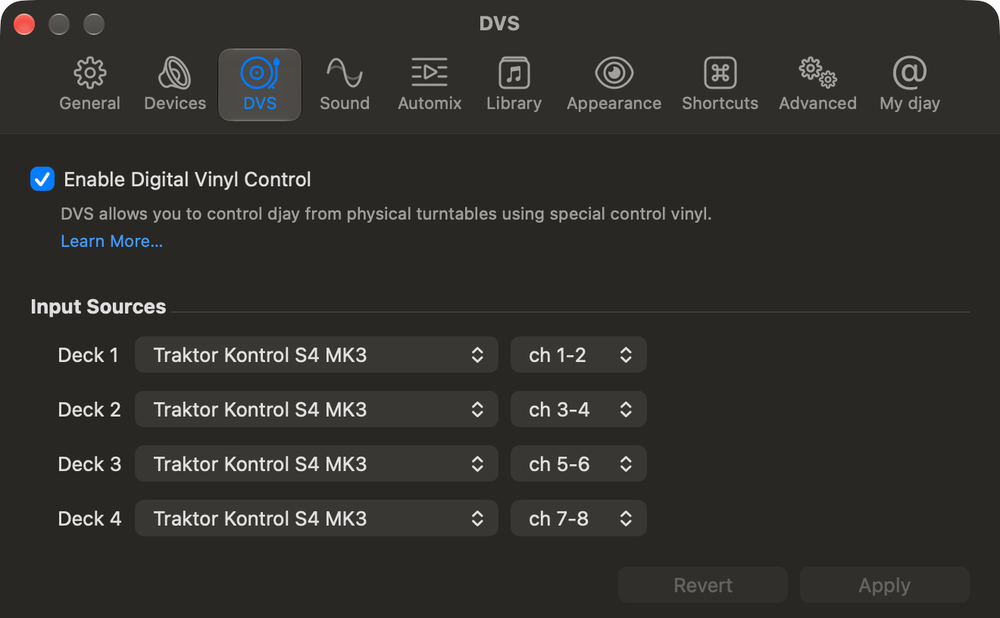

# S4 MK3 Bridge user guide

Use this guide to DJ with the S4 MK3, understand the custom mappings, and
recognize what its lights and screens are telling you.

**Build coverage:** this guide follows the full-controller 0.2.1-beta.1 build.
Version 0.1.1-beta.3 and older downloads lack its screens and updated control workflows.
Use the app and mapping supplied together; check the [download notes](../README.md#download-and-install)
for what the published package includes.
Backspin continuation, optional motor assistance, the lamp/FX-warning corrections
and Shift + effect-knob browsing are new since 0.2.0-beta.1. Install the
0.2.1-beta.1 mapping under a new name,
preserving custom maps, for Shift + effect-knob browsing.

EXT switching below is a **current-source, full-profile addition**, not a new
published release. It requires a newly generated matching mapping, installed
under a new name. EXT lamp locations are confirmed; integrated control
acceptance is tracked in the [validation record](ext-input-validation.md).

The DJ laptop needs the standalone app, not Rust, Cargo or this repository.

## Contents

- [One-time setup](#one-time-setup)
- [Start and finish a set](#start-and-finish-a-set)
- [Deck focus and transport](#deck-focus-and-transport)
- [Browse, preview and load](#browse-preview-and-load)
- [Loops and beat jumps](#loops-and-beat-jumps)
- [Mixing, cueing and Neural Mix EQ](#mixing-cueing-and-neural-mix-eq)
- [Manual FX strips](#manual-fx-strips)
- [Mixer Instant FX](#mixer-instant-fx)
- [Pads and sample banks](#pads-and-sample-banks)
- [Jog wheels and feel](#jog-wheels-and-feel)
- [Screens and feedback](#screens-and-feedback)
- [Settings: what needs saving or a new mapping?](#settings-what-needs-saving-or-a-new-mapping)
- [Troubleshooting](#troubleshooting)
- [Intentional differences and limits](#intentional-differences-and-limits)

## One-time setup

You need an Apple Silicon Mac, a supported macOS/Djay Pro combination, Djay
PRO access for custom MIDI mappings, and the powered S4 MK3 connected by USB.
The menu-bar app is currently macOS-only.

1. [Install the app](../README.md#download-and-install), then open it.
   Quit any older bridge app or standalone bridge first: run one instance.
2. In Settings, select **Full controller + LED feedback** and turn off
   **Stop after a fixed duration** for normal DJ use.
3. Click **Start bridge**. For screens, enable **S4 screens** and follow the
   NI-driver prompt described below.
4. Choose **Install Djay mapping...**, save under a new filename, and accept
   Djay's import. Keep your custom mappings under their existing names.
5. In Djay's MIDI configuration, enable **S4 MK3 MIDI Full** and select the
   configuration just imported. Its name may have a number appended.
6. Set Djay's audio device to the S4's native audio interface. Route **Main**
   to its speaker outputs and **Pre-cue** to its headphones. Audio does not
   pass through the bridge.
7. After selecting a different mapping, stop and start the bridge once.
   Confirm controls and headphone cue before using the speakers.

If Djay offers only a blank S4 configuration, restart Djay with the bridge
already running, then select the imported mapping.

### Let the app manage screen ownership

If NI's background screen driver is running, the app offers **Enable screens**,
**Continue without screens**, or **Cancel**. Enable screens temporarily stops
that driver. Optional automatic stopping and restoration are in the Screens
tab. Close Traktor, Maschine and Komplete Kontrol before handing over their
shared service; the bridge will not close those applications for you.

Continue without screens still runs MIDI, LEDs and saved tension. A red status
icon can mean requested screens are blocked, not that all controls stopped.
Use the app's recovery controls, not a separate driver-killing command.
See the [screen-driver guide](screen-driver-handover.md).

## Start and finish a set

### Before playing

1. Power/connect the S4 and open Djay and the bridge app.
2. Put the channel-volume faders at your intended starting positions,
   normally down for tracks you are cueing.
3. Start the full-controller bridge with the matching mapping selected.
4. Check Djay's channel volumes and EQ. After mapping feedback arrives, the
   bridge applies the physical volume and high/mid/low EQ positions once.
   Do not assume that synchronization has happened before the mapping connects.
5. Check gain, filter, tempo and crossfader position separately: they are not
   included in that startup push. Crossfader assignment switches and curve
   have their own startup synchronization.
6. Cue a track through headphones, confirm the selected deck, then bring its
   channel volume into the mix.

Later mouse edits are not repeatedly overwritten by unchanged hardware
snapshots. Shared FX knobs use pickup instead of being pushed on startup.
See [startup and pickup details](controls-state-sync.md).

### When finished

Pause playback or lower your outputs in the normal way, then use **Stop bridge**
or **Quit S4 MK3 Bridge**. Stop is not Djay's transport Pause button.
Closing the settings window alone leaves the bridge running in the menu bar.

To return to Traktor, stop the bridge and use **Restart Native Instruments
screen driver** if needed. With automatic restoration enabled, the app restores
a driver it stopped after releasing the controller. Turning only the screens
off does not hand the driver back during an ongoing bridge session.

## Deck focus and transport

| Physical side | Available decks | Djay deck numbers |
| --- | --- | --- |
| Left | A or C | 1 or 3 |
| Right | B or D | 2 or 4 |

Choose A/C or B/D before loading or working a deck. Its transport, pads,
encoders and wheel follow that focus. The four mixer channels remain assigned
to their own decks; changing the left focus to C does not turn A's channel
fader into C's.

| Control | What it does |
| --- | --- |
| PLAY | Djay play/pause |
| Deck CUE | Djay's cue/jump action, dependent on whether the deck is playing or paused |
| Shift+CUE | Jump to the beginning of the song, not the saved cue point |
| SYNC | Sync the selected deck |
| Shift+SYNC | Cycle the tempo-fader range for **all decks** |
| MASTER | Choose that deck as Djay's sync master |
| REV, held | Reverse while held; release ends reverse |
| FLUX | Toggle Djay Slip independently |
| QUANT | Send a quantize toggle to all four decks |

REV does not automatically switch Slip on or restore an earlier Slip state.
Use FLUX explicitly when you want Slip. Shift+SYNC is a global range change,
not Traktor's per-deck tempo-fader lock.
QUANT toggles each deck; it does not force already-mixed quantize states into
one uniform state.

FLX and REV have dim red backlights when Djay reports them off and bright
red indicators when Slip or reverse is active. They stay dark until their
software state is known. Their idle intensity follows the same palette
backlight setting as JOG, rather than the separate fixed-lamp inactive
brightness. Shift has a dim white backlight and brightens while held.

## Browse, preview and load

1. Select the destination deck with A/C or B/D.
2. Turn that side's **BROWSER** to browse the library.
3. Hold **Preview** to audition the selected track.
4. While still holding Preview, turn BROWSER to scrub the preview:
   clockwise forward, counterclockwise backward. **Shift is not required.**
5. Release Preview to stop auditioning.
6. Press BROWSER to load the selection into the deck chosen on that side.

Other library controls:

| Gesture | Action |
| --- | --- |
| Shift+BROWSER turn | Next/previous library source instead of track browsing |
| Shift+BROWSER press | Library Back |
| Star button | Djay's **Switch Library Table** action |
| Playlist button | Mark/unmark the selected song; not a rating or Queue toggle |
| Library View | Toggle library visibility |

Switch Library Table changes which library table you work in; changing source
is the separate Shift+BROWSER gesture. If Preview and Shift are both held,
**Preview wins** and BROWSER still scrubs.

Preview is implemented with toggle actions at the edges of the hold, not a
latched mode. If it was already playing or changed externally and becomes out
of sync, stop it with Djay's mouse control before trying another hold.

## Loops and beat jumps

LOOP length and MOVE jump length are independent. Each logical deck keeps its
own values in Djay.

### Set a loop

1. Turn **LOOP** to choose the loop length in Djay.
2. Press LOOP to activate it; press again to leave it.
3. While active, turning LOOP changes its size.
4. Shift+LOOP turn moves the loop region. Shift+LOOP press uses **Reloop**
   to reactivate a stored loop range.

On the S4, LOOP shows the active length with green fill, or **OFF** when no
loop is active. It does not show the preselected inactive length; look at
Djay's selector while choosing that.

### Choose a jump length and move

1. Press **MOVE** to enter jump-size selection for this deck.
2. Turn MOVE to choose the jump length. The value changes immediately in Djay.
   The deck selector pulses; the screen shows **SELECT**.
3. Press MOVE again to leave selection. This exits the mode, not a deferred save.
4. Turn MOVE to jump by that length. With an active loop, beat jump moves the
   loop region by the jump length.

Selection has no timeout. It survives a deck switch and clears when the bridge
restarts; it does not mean the native jump length itself resets.

For example, choose an 8-beat jump, then turn MOVE normally for 8-beat moves.
Hold Shift while turning MOVE for 1-beat adjustments, including while SELECT
is active. The bridge restores the **last confirmed** jump length afterward.

If JUMP is `?`, the previous size is not known reliably. Shift+MOVE still
selects and jumps one beat, but cannot restore an unknown size. Establish a
confirmed size first. Manual loop-in/out is not mapped.

## Mixing, cueing and Neural Mix EQ

Channel volume, gain, high/mid/low EQ and filter control the corresponding
Djay channel. Use the **small channel headphone/CUE button** for pre-cue,
not the deck's large transport CUE button. Master, booth, headphone level and
headphone mix remain hardware-local controls.

Crossfader assignment switches choose a side or **THRU**. THRU means the channel
bypasses the crossfader, not that it is muted. Djay may show **Crossfader
assignment changed**; choose **Keep** to retain the physical assignments.
**Restore** changes them to Djay's defaults.

### Change a channel's EQ mode

1. Press the mixer **Filter** button. It flashes cyan, waiting for a deck.
2. Press that channel's **ON** button to toggle its normal/Neural Mix EQ mode.
3. To cancel without changing a deck, press Filter again.

This does not change the Instant FX target. Outside this selection workflow,
channel ON chooses the Instant FX target; it is not a channel mute button.
Filter no longer resets the software filter.

ON is white for normal EQ and cyan for Neural Mix EQ, brighter on the selected
Instant FX target. An active Instant FX temporarily takes over its color.
Dark/unknown feedback is not proof the deck is muted.

### External audio through a deck

Djay can mix an S4 audio input through a deck in **DVS THRU** mode. The
channel 4 route has been confirmed with the bridge running, including its
channel fader, FX and mix/cue.

#### Required Djay DVS setup

**Turn on DVS before using EXT.** The bridge cannot enable it for you.

1. Open Djay **Settings > DVS** and check **Enable Digital Vinyl Control**.
2. Under **Input Sources**, select **Traktor Kontrol S4 MK3** for each deck
   you want to use with an external source, using the stereo pairs below.
3. Click **Apply** after changing the assignments. Leave DVS enabled, even
   when playing normal tracks in **Internal / INT** mode.

For all four channels, configure:

| S4 input | Available source types | USB input channels |
| --- | --- | --- |
| A | PHONO / LINE | 1-2 |
| B | PHONO / LINE | 3-4 |
| C | LINE / MIC C | 5-6 |
| D | LINE / MIC D | 7-8 |

_Djay Settings > DVS configured for all four S4 inputs. Apply is disabled
once the assignments have already been applied._

These are audio input channels, not MIDI channels. Selecting another source
type on the same S4 input does not give it a separate USB pair.

For input D, including the front MIC D socket:

1. Select the appropriate S4 input type with **Shift+EXT**: LINE for rear
   input D or MIC D for the front microphone. Keep listening levels down
   while selecting or connecting a source.
2. Start the full-controller bridge with its matching mapping selected in
   Djay, after completing the DVS setup above.
3. With the current-source full profile and matching mapping, press **EXT 4**
   without Shift to switch Deck 4 from Internal to **Thru** once its mode
   feedback is available. You can also select Thru in Deck 4's **DVS control-mode
   menu beside Play**. This is different from the crossfader's THRU assignment.
4. Set channel level and cue/mix normally. If the same input is also selected
   as Djay's global Microphone, leave that microphone route off to avoid
   mixing it through a second path.
5. Once Djay reports THRU, press **EXT 4** again to choose **Internal / INT**
   and return to normal track playback, or choose Internal in the same menu.

**Leave Enable Digital Vinyl Control checked** when using external inputs.
You can leave it on while playing normal tracks in Internal mode. A MIDI
THRU command does not enable this setting for you, and the available deck-mode
feedback cannot reliably tell the bridge whether it is off. If an external
input will not activate, first check this checkbox and the deck's input
assignment in **Settings > DVS**.

**EXT 1-4 always address decks 1-4**, regardless of A/C, B/D or FX selection.
Each new unshifted press uses the latest actual THRU feedback: THRU selects
Internal, and not-THRU selects Thru. Missing feedback means no switch and a
dark lamp; the bridge doesn't guess or queue a toggle. Release EXT before
trying again. Holding it cannot repeat a command, even if feedback arrives
or Shift is released during the hold.

Holding **either Shift** suppresses software EXT commands, leaving
**Shift+EXT** for hardware input-type selection. The EXT lamp lights only
when Djay reports THRU for that deck. Not-THRU and unknown state stay dark,
even with dim idle lamps enabled. A lit lamp doesn't confirm global DVS is
enabled or that audio is arriving.

The input-pair map and physical EXT lamp locations are confirmed. Integrated
switching/indicator acceptance is tracked in the
[validation record](ext-input-validation.md). Complete mixer-control behavior
on the other channels, phono-stage behavior and four simultaneous external
sources still need separate validation.

## Manual FX strips

The two top FX strips each control three manual effect slots on one deck.
They are **control targets**, not Traktor-style shared FX audio buses.

1. Press a channel's **FX1** button to target it from the left FX strip, or
   **FX2** for the right strip.
2. Use strip buttons **1-3** for individual effects.
3. Hold Shift on the strip's physical side and turn parameter knob 1, 2 or 3
   clockwise for next effects or counterclockwise for previous effects in that
   slot. Movement is relative, not an absolute position in the effect list.
   Shift + an effect button still chooses its next effect as a shortcut.
4. Release Shift to adjust parameters with knobs 1-3. After browsing, move
   through the software parameter's pickup position before it responds.
5. Use the shared dry/wet knob for their wet/dry amounts.

Each browsing step uses about 1/32 of the knob's travel. Small movements
accumulate; a larger turn can scroll several effects. These knobs have end
stops: release Shift, reposition, then hold Shift again to continue browsing.
Repositioning does not select effects, but crossing the software parameter
value picks it up and resumes parameter adjustment. Dry/wet remains a wet/dry
control even with Shift held.

Defaults are A for the left strip and B for the right. Changing A/C or B/D
deck focus does not automatically change these targets.

### Pick up a software value without a jump

After startup, retargeting or an external software edit, a physical FX knob
can disagree with Djay. Its movement is held until it reaches or crosses
the software position.

- A blinking effect button means its parameter knob needs pickup.
- A blinking strip ON means dry/wet needs pickup.
- Move toward and through the value shown in Djay until the blink stops.
- Dry/wet reaches three software slots; each picks up independently. Its
  warning clears when all three have been picked up.
- An `FX SYNC` screen header identifies the affected deck and controls.
  A `?` there means feedback is missing, not a confirmed mismatch.

After pickup, ordinary knob movement does not flash a new warning while
Djay returns the updated values. A mouse edit in Djay or a different FX
target can require pickup again.

The strip's main **ON is not a reliable whole-bank bypass**: the current
binding duplicates slot 1. Use the individual effect buttons or Djay's UI
when you need to turn the other slots off.

## Mixer Instant FX

These are separate from the two manual FX strips:

1. Press a channel **ON** without Filter selection armed to choose the target.
   **FX SELECT** also cycles the central target.
2. Hold a mixer FX button 1-4 to apply its assigned Djay Instant FX.
3. Release to end the held action.

The target defaults to A. Selecting a target does not route audio into a shared
effect bus. A held effect stays with the deck where it began until release;
changing targets does not move that held effect to the new deck.

## Pads and sample banks

| Mode | Pads | Shift |
| --- | --- | --- |
| HOTCUE | Trigger/set hotcues 1-8 | Clear the corresponding hotcue |
| SAMPLES | Trigger sampler players | Stop their playback |
| STEMS or MUTE | Pads 1-4 mute; pads 5-8 solo | Pads 1-4 exclusive solo; pads 5-8 stay ordinary solo |

A/C share sampler bank 1; B/D share bank 2. Selecting another deck on the same
physical side does not give you an independent new sample bank.

The STEMS columns are **Drums, Bass, Harmonic, Vocals**, in that order. The
lower four pads solo the same columns. Shift makes the upper row **ONLY**
so you can select one stem exclusively. MUTE is a mode-selection alias for
STEMS, not a held modifier and not a button that mutes the entire deck.

Neural Mix availability depends on the track and Djay support. The screen
reports actual mute/solo state; ON in a MUTE tile means that mute is active.

**REC is not the set recorder.** It is assigned to Djay's Record Sample
action, whose source/slot and press/hold behavior remain unresolved. Use
Djay's onscreen recording controls when you want to record a mix.

## Jog wheels and feel

**In the current-source testing build, JOG and TT are independent toggles.**
JOG toggles Vinyl: red enables top-touch scratching; blue disables top-touch
scratch and retains bend/nudge behavior. Normal mode starts with Vinyl on;
TT mode starts with Vinyl off. Jog settings have separate startup preferences
for the two modes. Switching modes restores that mode's last Vinyl choice
for the current bridge session.
TT enables motorized playback on that physical side and starts off each time
the bridge starts. Rotation follows actual playback feedback for the selected
deck, not a press of Play. Install/select the newly generated mapping under
a new filename: it adds explicit Internal-mode feedback required by this experiment.
The selected deck must be loaded, playing and confirmed Internal, not THRU
or DVS. Shift+jog seeks.
If TT lights blue but the platter stays still, open Diagnostics at **Info**
log detail. `MOTOR_TT_SELECTION` confirms the press; `MOTOR_PLAYBACK_GATE`
lists the selected deck and blocking conditions. `internal_mode_unknown`
means Internal-mode feedback has not arrived: install and select this app's
newly generated mapping, then stop and start the bridge. Preserve your existing
mapping under its old name. A selected TT light is not proof of motor output.
GRID+jog edits the beat grid rather than performing an ordinary nudge.
A detected backspin can keep scratching after you lift your hand, following
the wheel's actual movement rather than switching immediately to nudge.

### Change physical resistance

In **Jog > Hardware > Jog Wheel Tension**:

| Setting | Effect |
| --- | --- |
| Assist, -100 to -1 | Helps a wheel's own movement while its metal top is touched |
| Neutral, 0 | No added tension; first-install default |
| Brake, 1 to 100 | Resists movement, including after release |

Both wheels share the setting but respond independently. It is not assigned
to a mixer fader or saved separately per logical deck.

### Change Djay's scratch/bend response

The other Jog sections control **Speed** and **Reaction** in the exported
Djay mapping. Defaults are scratch **2.7% / 150%** and pitch bend **2.7% / 17%**.
These change software response, not motor force.

Tension, motor-force and Vinyl-startup values are runtime preferences and need
saving/restarting. Scratch and pitch-bend mappings, touch-scratch direction and
absolute platter sensitivity need a newly exported mapping selected in Djay.
Haptic cue points remain unavailable.

### Backspin detection

In **Jog > Backspin**:

- **Detection** recognizes a sharp backward acceleration while you scratch in
  Turntable mode. Ordinary scratch releases still return immediately to nudge.
  JOG, Shift-seek and GRID gestures do not start backspin events.
- **Acceleration threshold** controls how hard a backward flick must be.
  Higher values need a sharper flick; lower values detect more easily.
  The starting value is **150000 counts/s^2**, using filtered wheel movement.
- **Scratch speed increase** adds to the normal Scratch speed only during a
  detected event. It defaults to **5.6%**; **0.0%** preserves normal travel.
  For example, a **1.0%**
  increase over **2.7%** gives an effective **3.7%** during the backspin.
  Keep the app's normal Scratch speed matched to the mapping selected in Djay.
- **Motor assistance** is a separate, experimental option, **on by default
  at 100% strength**.
  **Motor assist strength** selects **0-100%** of the existing maximum, only
  for the wheel in a detected backspin. **100%** is the original maximum;
  **0%** bypasses the override, just like switching motor assistance off.
  After you lift your hand, assistance fades to zero over one second. Continued
  spinning cannot extend that deadline or start another pulse without a new
  touch gesture. Your saved Jog Wheel Tension setting is not changed.

These defaults apply to fresh preferences and missing fields in older files.
Explicit saved settings, including zero speed increase or motor assistance off,
are preserved when upgrading.

The wheel's screen shows **BACKSPIN** and its owning deck while detection is
active, including before release. Use that indicator to spot unwanted
detections before changing the threshold or adding speed.

After release, movement stays on the deck that started the backspin, even if
you select another deck. It ends when the wheel settles, reverses direction,
or you touch it again. **Stop in the bridge app** also releases the scratch
hold and clears motor force. MIDI movement is not invented after the platter stops.

With motor assistance enabled, retouching, stopping/reversing the wheel or
cancelling its mode ends the assist pulse early. The existing input-freshness
cutoff also clears it. Your normal tension behavior resumes after the override.
The **BACKSPIN** indicator can remain visible after the one-second motor fade:
scratch continues to follow the remaining real coast, without extending motor
assistance. Disabling detection disables the assist controls without forgetting
their saved checkbox or strength values.

These options apply after **Save preferences** and the next Start, or **Save
and restart**. They do not need a mapping export. Compare with motor assistance
off first; software speed increase and motor assistance change different parts
of the feel. This is gesture-driven assistance, not playback-driven platter rotation.

You can make your own repeated comparisons in the app: choose assist off or a
strength, use **Save and restart**, wait for **Running**, then repeat the same
flick and release. The slider does not change a running motor until you apply
it. Keep normal Jog Wheel Tension and Scratch speed increase fixed while
comparing motor levels; neither is changed by the strength control. No mapping
reinstall is needed.

### Testing motorized playback

The **Testing: Motorized playback** section in Jog settings retains the
experimental tuning controls for comparison during actual DJ use. These are
not settled release options. The starting values are 33 RPM, maximum force
20000, base force 1650, force per RPM 110, Kp 4000, Ki 3000, force rise
200000/second, startup 200 ms, immediate startup force step and overspeed
abort disabled. Save and restart to apply changes; controls are not live.

Unlike the diagnostic's MOVE-armed pulse, TT playback has no 15-second
duration limit. Switch TT off or pause the selected deck to remove drive.
In this diagnostic, physical touch and Scratch ownership do not cut TT force.
Braking, holding and reversing use bounded constant forward assistance; the
speed regulator does not accumulate error against your hand. With the starting
settings this assistance is 5280 force units, capped by maximum force, not a
measured physical torque. Normal tension and backspin motor assistance do not
add to it. Sensor loss clears force and requires a new baseline and fresh
20 ms sensor window before recovery.
In the current relative-pitchbend test build, when TT is authorized and the
wheel is not touch-owned, only deviation from the configured target RPM produces
signed relative Pitch Bend CC 4 steps for the selected deck's `pitchBendMove`
mapping. Speed uses a rolling 100 ms measurement, but corrections follow fresh
input reports rather than arriving in 100 ms bursts. Startup and recovery first
require measured rotation within 0.75 RPM of the target. Corrections then start
only beyond 2 RPM deviation and stop when rotation returns within 0.75 RPM.
This testing filter favors quiet steady rotation over subtle nudges.
Slower rotation sends negative corrections; faster rotation sends positive
corrections. The nominal rotation itself is subtracted.
The current stronger-braking test doubles negative motorized corrections while
leaving forward nudging at its original strength. This is a command multiplier,
not a guaranteed percentage of audible slowdown. Manual TT-off jog and top-touch
Scratch keep their existing response.
With TT selected and Vinyl off, slowing to the **TT pitch-bend floor**
switches from CC 4 to held Scratch mode and raw relative CC 5 movement.
The initial diagnostic floor is **50% of target RPM** (16.5 RPM at 33 RPM);
it is adjustable from 1 to 95% in Testing. This is provisional: the supplied
tone recording reached half speed, but the CC 4 mapping's actual floor has
not been established. Acceleration above the floor plus hysteresis returns
to pitch bend without needing top-touch release. At the default settings the
exit is 18.5 RPM. Switching deck or losing playback authorization releases
the original speed-Scratch owner and neutralizes drive.
The same setting now defines a symmetric upper ceiling: `200% - floor`.
At the default 50% floor, reaching 150% of target (49.5 RPM at 33 RPM)
also enters Scratch; slowing back to 47.5 RPM releases the upper handoff.
Both bounds are provisional diagnostic values, not measured CC4 limits.
Above-target rotation without physical touch remains under speed regulation
even while the upper Scratch MIDI handoff is active; it does not select constant
forward assistance solely because Scratch is held.
See the [diagnostic calibration and attended checks](tt-speed-scratch-diagnostic.md).
There is no absolute CC 8 position stream in this test path. Ordinary top-touch
Scratch remains on relative CC 5.
**Absolute platter sensitivity** in Testing starts at **14.0%** based on the
first timed trial and can be adjusted from **0.1 to 100%** independently of
manual Scratch speed. It controls the generated CC 8 mapping and does not tune
this relative CC 4 experiment. Tune the Djay Pitch Bend mapping's sensitivity
for this test.
The retired [absolute-position Scratch experiment](absolute-position-scratch-experiment.md)
is documented separately for future software compatibility work.
The touch-scratch direction picker offers **Normal** and **Reversed** for the
manual CC 5 route only.
Nominal TT rotation does not hold Djay's `scratchingMode` state. The new
speed-floor handoff can hold it with Vinyl off; Vinyl on retains conventional
top-touch Scratch ownership while continuing bounded TT assistance.
Physical coverage and remaining limits are recorded in the
[integration validation record](motorized-playback-integration-validation.md).
For diagnostics, set log detail to **Debug** and look for
`MOTOR_JOG_BEND` to confirm relative CC 4 movement, and `MOTOR_JOG_POSITION`
to observe the encoder-derived angle. These confirm bridge output, not that
Djay produced the intended audible speed.
For a longer trace, select the **Full** profile and **Debug** before starting
the bridge, then choose **Start motor diagnostic capture** before the test and
stop the capture afterward. The app writes timestamped
`MOTOR_JOG_BEND`, `MOTOR_JOG_POSITION`, `MOTOR_SCRATCH_MODE`,
`MOTOR_SCRATCH_HANDOFF`, `MOTOR_TT_SELECTION` and `MOTOR_PLAYBACK_GATE` lines to a separate file under
`~/Library/Application Support/S4 MK3 Bridge/diagnostics/`; **Show file**
reveals it in Finder. Unlike the Diagnostics display, this filtered file is
not limited to 60,000 characters.

**For this testing build, turn TT off or Stop bridge before quitting Djay.**
Playback authorization is cached from real feedback; silence from Djay does
not itself clear a previously reported playing state.
Integrated physical feel and playing acceptance are tracked separately in
the [integration validation record](motorized-playback-integration-validation.md).
This is current-source testing behavior, not a published release.
The Testing settings remain available during beta testing. Before release,
the settings exposed to ordinary users will be reviewed; no options are removed
by this documentation update.

The separate [attended platter diagnostic](platter-diagnostic.md)
measures motor response and physical ring following without controlling Djay.
Current source also provides a short target-speed probe, armed with MOVE,
with a two-second powered window by default and an optional window up to
15 seconds for repeated rim-feel checks. Its 33 RPM/8,000-unit defaults use
sensor-timed feed-forward and PI feedback. The standalone command lets you
adjust the force ceiling, feed-forward curve, PI gains and startup behavior
for each attended run; the log records the selected values. Change the command
between runs; values are not adjusted live or saved to the bridge app. For a
trial, you can also override the overspeed cutoff or set it to zero to disable
that cutoff; the direction and sensor-freshness guards remain. Clear both
platters and wait for the terminal to show
`PLATTER_STATE gate=Ready` before arming MOVE. Top-plate touch cancels drive,
and lifting does not restart it; this does not enable scratching. Separate
rim-brake and forward-nudge checks compare recovery. The current feel remains
different from Traktor; see the diagnostic guide for the adjustable values
and run procedure.
Run it separately from the bridge, only during an attended test.

## Screens and feedback

HOTCUE and SAMPLES show **JUMP / LOOP / KEY / RANGE**. STEMS and MUTE show the
mute/solo legend. The selected A/C or B/D deck supplies the corresponding screen.
There is no title, artwork, BPM, time or waveform display.

| Indication | Read it as |
| --- | --- |
| Pulsing deck selector / SELECT | MOVE is choosing jump size, not a connection fault |
| LOOP OFF | No active loop; not the inactive selected length |
| KEY `--` | Djay reports no musical key |
| KEY `?` | Missing/unrecognized key feedback |
| FX SYNC / blinking FX control | A shared knob needs pickup, or its feedback is missing |
| BACKSPIN A/B/C/D | That wheel is in a detected backspin owned by the named deck |
| Red running status icon | Requested screens are blocked/failed; check the Screens tab |

The musical-key load-order bug is fixed in the current build: replacement
preserves the newly reported key, and eject uses Djay's explicit no-key value.
It does not guess a key or retain an old track's key as a fallback.

Most playback, pad and meter indications follow Djay feedback; selection and
physical-hold indicators also represent local bridge state. Normal-mode rings
advance while the deck plays, follow Scratch movement and freeze in place when
paused and untouched. Releasing Scratch resumes playback animation from that
same position, without a jump. Each logical deck keeps its phase and original
Scratch ownership. The normal animation period uses `chase_period_ms`; it is
not an absolute track playhead. TT rings remain tied to physical wheel rotation.
Whole-ring loop flashing takes precedence and restores the current mode's phase
when the loop exits.
See the [screen reference](screens.md) and [LED reference](led-feedback.md).

## Settings: what needs saving or a new mapping?

| Change | How to apply it |
| --- | --- |
| LED colors, brightness, meter appearance | Save preferences while stopped, or Save and restart while running; no mapping export |
| Hardware jog tension | Same save/restart actions; no mapping export |
| Jog scratch/bend Speed or Reaction | Save, export with Install Djay mapping..., import and select that new mapping in Djay |
| Backspin detection, threshold or speed increase | Save preferences and restart the bridge; no mapping export |
| Screens on/off and NI handover options | Screen controls save immediately; use their live actions |
| A build with changed MIDI bindings/feedback | Install/select its matching mapping under a new filename, then restart the bridge |

Mapping export uses the current Jog editor values. Saving or restarting alone
does not change Djay's selected mapping. Preserve custom maps when importing.
A runtime-only key fix does not require a new mapping if the current numeric
feedback is already present.

LED and Palette preferences can be imported/exported. These LED exports are
not a backup of every app preference or your custom Djay mapping.
Saved settings survive app updates. Technical files live under
`~/Library/Application Support/S4 MK3 Bridge/`; normal setup does not require
editing them.

## Troubleshooting

| Symptom | First action |
| --- | --- |
| No controls or LEDs | Check power/USB, full profile, running status, and S4 MK3 MIDI Full's selected mapping; rule out a second bridge instance |
| Changed mapping or restarted/reconnected Djay | Stop and start the bridge to reinitialize feedback-dependent startup state |
| Channel level/EQ did not match at startup | Confirm the matching mapping is connected and sending feedback, then restart; check the excluded controls separately |
| FX knob seems ignored or blinks | Check its target deck, then cross the software pickup value; missing feedback needs the matching mapping |
| Jumps are one beat after Shift+MOVE | Confirm JUMP feedback and the matching mapping before relying on size restoration |
| Preview stays playing | Stop Preview with the mouse to resynchronize the held workflow |
| Screens show logos, stay dark, or status is red | Use Settings > Screens and the app's NI handover/recovery controls; do not start a second screen prototype |
| Return to Traktor after a crash | Use Restart Native Instruments screen driver; accept Stop bridge & restore NI driver if prompted |
| USB was disconnected | Reconnect and explicitly start the bridge again |

Brief input gaps suspend tension and allow it to recover after fresh readings
and newly qualified movement. That is different from a bridge exit. If the
bridge actually stops with an error, keep the Diagnostics log and report the
exact message rather than assuming the timeout-recovery path ran.

If Djay shows a key but the latest S4 build shows `?`, retain the track and
record the deck, title and Djay key before restarting. For a report, also
include app release/build, macOS/Djay versions and selected mapping name.
Copy relevant Diagnostics output and check it for private information.

## Intentional differences and limits

- LOOP and MOVE have independent lengths, rather than Traktor's shared length.
- Shift+SYNC changes global range; it does not lock one deck's tempo fader.
- REV and Slip are independent.
- Channel FX1/FX2 choose manual control targets, not shared audio buses.
- Filter then ON chooses an EQ-mode change; ordinary ON targets Instant FX.
- MUTE selects the STEMS layer rather than acting as a held modifier.
- The main FX ON and REC have the limitations described above.
- Current-source full-profile EXT switches fixed decks between THRU and Internal
  using actual feedback and a new matching mapping. DVS enable and input
  assignments remain manual. Switching and lamps are confirmed on all four
  channels; broader audio checks remain separate. Don't assume factory
  Traktor behavior.
- Djay can coalesce very rapid separate jump commands. This is distinct from
  the confirmed-size restoration fix.

For every binding and lower-level detail, use the
[bridge function reference](bridge-function-reference.md). The
[Traktor comparison](traktor-djay-comparison.md) explains the factory
differences; its historical rows are superseded by its current overlays.
The [issue checklist](issues.md) tracks remaining work.

This guide is the maintained explanation of current workflows. Control,
mapping, setup and feedback changes should update the relevant section here
alongside their technical reference.
